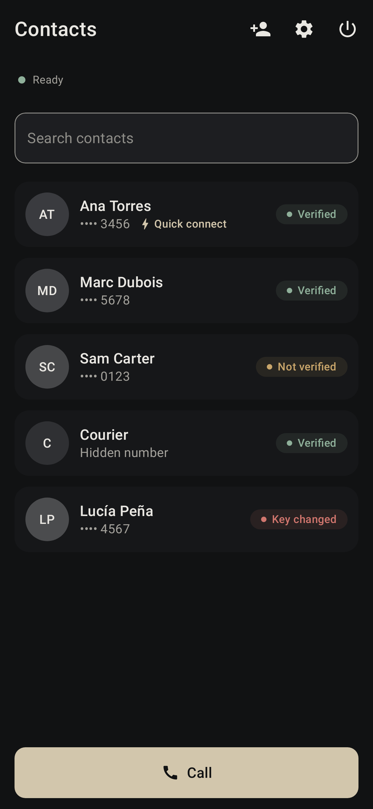
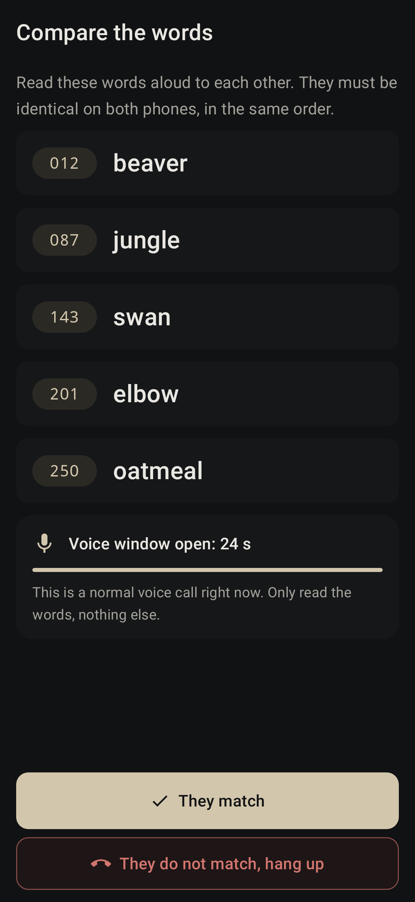
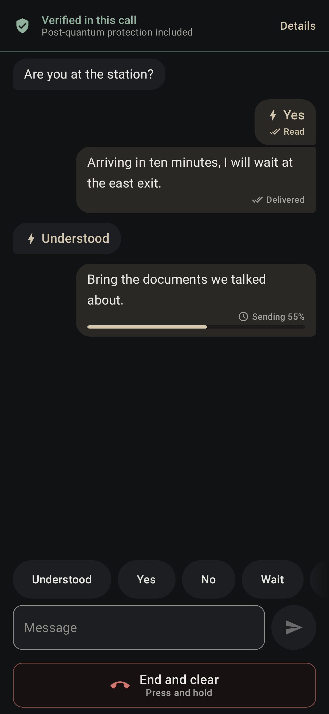
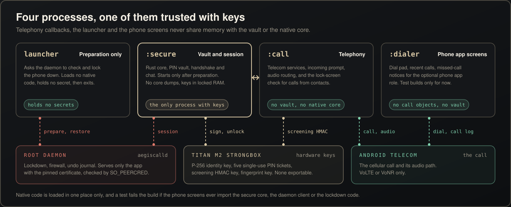

<p align="center">
  
</p>

# DialCrypt — Post-Quantum Data over Voice

**End-to-end encrypted messaging over cellular voice calls (VoLTE/VoNR) — no `INTERNET` permission, no server, no account, no cloud.**

DialCrypt is an open-source **secure communication research** project exploring **encrypted messaging without Internet** by transmitting ciphertext as **data over voice** across an ordinary **cellular voice channel** between two rooted Google Pixel devices.

It combines a custom Rust **voice-band modem** with **digital signal processing (DSP)** and **forward error correction (FEC)** designed for **AMR-WB / EVS codec** speech paths, **hybrid post-quantum cryptography** (`X25519 + ML-KEM-1024`), **hardware-backed cryptography** inside Titan M2 Android StrongBox, and **Android security hardening** through a root lockdown daemon and **Android telephony audio** process isolation.

**Status:** Pre-alpha research prototype. Initial two-phone VoLTE testing completed; independent security review pending.

<p align="center">
  <a href="LICENSE"></a>
  
  
  
  
  
</p>

<p align="center">
  <strong>English</strong> · <a href="README.zh-CN.md">简体中文</a>
</p>

> [!WARNING]
> **DialCrypt is a pre-alpha research prototype.** It has not had a third-party security audit, it has completed only a small number of real VoLTE calls between two test phones, and it must not be used to protect anyone's physical safety. The [Status](#status) section lists what is done and what is not.

<table>
  <tr>
    <td width="25%" valign="top">
      <strong>Ciphertext in the sound of a call</strong><br>
      When data networks are blocked, watched or switched off, a voice call still connects. A modem written in Rust turns sealed frames into tones that ride an ordinary VoLTE or VoNR call through the carrier's speech codec.
    </td>
    <td width="25%" valign="top">
      <strong>No network surface at all</strong><br>
      The manifest declares no <code>INTERNET</code> permission. During an armed session a root daemon turns the radios off and loads firewall rules that drop everything except the call's own signalling and media.
    </td>
    <td width="25%" valign="top">
      <strong>Post-quantum, rooted in hardware</strong><br>
      <code>X25519 + ML-KEM-1024</code> key agreement, P-256 identity signatures made inside StrongBox, Android Key Attestation chains checked on both sides. No StrongBox, no start: there is no software fallback.
    </td>
    <td width="25%" valign="top">
      <strong>Counted by silicon, built to be forgotten</strong><br>
      Five single-use StrongBox keys enforce a five-try PIN limit. On phones whose security chip enforces single-use keys, a restored backup cannot reset it. Messages live only in locked RAM, and a duress PIN destroys the keys and the vault.
    </td>
  </tr>
</table>

<p align="center">
  
  
  
</p>

<p align="center"><sub>Screenshots use test data. Left to right: contacts, the five-word voice check, a verified chat.</sub></p>

<p align="center">
  <a href="https://www.youtube.com/watch?v=YZn9QQuQKfE">
    
  </a>
</p>

<p align="center"><sub>▶ <a href="https://www.youtube.com/watch?v=YZn9QQuQKfE">Watch demo on YouTube: DialCrypt – Encrypted Messaging over VoLTE | Rust Modem &amp; Post-Quantum Cryptography</a></sub></p>

## Contents

- [Built from scratch](#built-from-scratch)
- [How a secure call works](#how-a-secure-call-works)
- [The stack](#the-stack)
- [The modem: data over voice](#the-modem-data-over-voice)
- [Lockdown daemon](#lockdown-daemon)
- [Process isolation](#process-isolation)
- [Vault, duress and fingerprint](#vault-duress-and-fingerprint)
- [Why DialCrypt](#why-dialcrypt)
- [Threat model and limits](#threat-model-and-limits)
- [Repository layout](#repository-layout) · [Build](#build) · [Status](#status) · [Development notes](#development-notes) · [Documentation](#documentation)

## Built from scratch

DialCrypt is not a wrapper around WebRTC or a messaging SDK. The modem, the handshake, the vault, the daemon and the keyboard were all written for this project, in Rust and Kotlin, because the usual building blocks assume an internet connection. Eight parts are worth a closer look. Each one names the code that implements it.

**1. A PIN limit held by single-use StrongBox keys** (`aegiscall-trust`)

Android gives apps no counter that survives a restored backup, so an attacker who copies an encrypted vault can normally guess forever. DialCrypt seals its vault under five StrongBox HMAC-SHA256 keys created with `setMaxUsageCount(1)`: each can sign once, and a wrong PIN uses one up for good. The PIN is first stretched with Argon2id (64 MiB, 3 passes). A correct PIN re-seals the vault under five fresh keys and deletes the old ones, so every earlier copy of `vault.v2` is dead on phones whose security chip enforces the single use (see below). The normal and the duress wrap have the same length and format and are stored sorted by bytes, and the file is padded to 4 KiB blocks.

How strong this limit is depends on the phone. Before a PIN is set, the app checks that a test key really refuses a second use, and refuses the PIN otherwise. When the phone declares `android.hardware.keystore.single_use_key`, StrongBox itself enforces the single use and restoring a backup cannot reset the count. Without it, as measured on 2026-11-24 on a Pixel 7 and a Pixel 7a running Android 16, Android Keystore counts the uses: without root the limit is still five tries, but software with root access can reset the count and reopen an old copy of the vault. On such phones the PIN setup screen says so; choose a long PIN there.

<p align="center">
  
</p>

**2. A modem that survives speech codecs** (`aegiscall-modem`, `aegiscall-jni/src/audio.rs`)

AMR-WB and EVS are built to carry voices: they bend phase, squeeze anything that is not speech, and drop or insert samples in the jitter buffer, while the two phones' audio clocks drift apart. The modem answers each of these. A 400 ms rising-and-falling chirp preamble (600 to 1900 Hz) finds frame timing and estimates carrier offset. A rate-1/2, K=7 convolutional code with soft-decision Viterbi decoding and a 384-bit interleaver absorbs bursts. Each subband is compensated for the channel's tilt, and a clock tracker stretches or shrinks the frame step during the call; the test suite runs it at -116 and -200 ppm of crystal skew with 40-sample buffer jumps.

**3. Data that is shaped like a voice** (`Speech300` in `speech.rs`)

A classic modem sends a steady pilot and a mechanical buzz, which is exactly what a speech codec's noise suppressor removes. `Speech300` instead synthesizes its frames as a voice-like waveform: a pitch contour moving between 102 and 156 Hz over seven syllables per superframe with aperiodic multi-phrase prosody, glottal-pulse excitation, three formants that glide together, seven classes of consonant onset, a frame-stateless harmonic comb pitch estimator, and a vowel glide as the preamble. Both `Robust300` and `Speech300` can be selected in Settings for codec-heavy or stealth-oriented calls.

**4. A handshake that ignores caller ID** (`aegiscall-crypto`)

Caller ID can be forged or withheld, so it decides nothing. The dialer marks its 77-byte `HS1` with blinded tags for the contact it dialed; the answerer fills the same fields with random bytes, matches the dialer's tags against every secret in its vault, and announces the result in a 2-byte `PATH` message that both sides hash into the SHA-384 transcript before any key is derived. Then come X25519 and ML-KEM-1024, and P-256 identity signatures made inside StrongBox and sealed so that identities stay hidden from the line. Verified contacts reconnect through a two-slot rolling secret (`rs_cur`, `rs_new`): neither phone drops the old secret until an encrypted `RESUME_SAVED` frame proves the other one stored the new one, so a call that drops mid-update cannot leave the two out of step.

**5. Recognizing a contact on a locked phone, without storing numbers** (`ScreeningStore`, `ContactNumberIndex`)

The call screens run in a process that cannot open the vault, yet they must know whether the caller is a saved contact. They ask a StrongBox HMAC key instead of a list: `screen.bin` is always 32,004 bytes, 1,000 slots filled with either a keyed tag or random bytes, so the file shows neither a number nor how many contacts exist. A second index keeps only 20 bits of an HMAC of each number's last digits, enough to mask a contact's number on the call screen and far too little to list contacts from the file.

**6. A firewall that leaves only the call** (`aegiscalld`)

Cutting all networking would kill VoLTE; allowing the whole IMS interface would leave a side channel. The daemon identifies its caller with `SO_PEERCRED` and a pinned signing certificate, writes an fsynced undo journal with a CRC32 on every line, turns off Wi-Fi, mobile data, Bluetooth, NFC, UWB and USB data, limits the baseband to LTE and NR, and loads `iptables` and `ip6tables` rules that accept loopback, IPv6 neighbour discovery, IMS traffic to the active P-CSCF and at most four media endpoints, which it learns through `NFLOG` only while a call is up. Everything else is dropped.

**7. Secrets that stay out of reach of the system** (`aegiscall-memsec`, `SecureInput`)

Android compresses idle memory into `zram` and Java strings linger until the collector gets to them. Session keys and messages are kept in Rust buffers that are locked in RAM (`mlock`), excluded from dumps (`MADV_DONTDUMP`, `PR_SET_DUMPABLE=0`) and zeroized on drop. Text is typed on the app's own keyboard, so nothing passes through a system input method, the PIN keypad is shuffled on every entry, and the PIN is handled only as `CharArray` and `ByteArray` buffers that are cleared in `finally` blocks, never as a `String`.

**8. Pairing cards that hold no secret, in QR codes that scan** (`pairing_v2.rs`, `QrCode.kt`)

A pairing code is 68 bytes: a version, the P-256 identity key, an X25519 pairing key and a CRC. Two contacts derive their pairing secret with an X25519 exchange between their cards, so a photo of both QR codes, or the app that carried both cards, cannot compute it. The QR encoder is pure Kotlin, and it rejects any mask whose data area happens to contain a pattern that scanners mistake for a finder: without that check, up to one invite card in eight failed to decode in testing.

## How a secure call works

<p align="center">
  
</p>

1. **Prepare and harden.** Open the app (it is called Notes on the launcher). Before any native code or secret is loaded, the launcher asks the root daemon to check the phone and lock it down. Then you unlock the vault with your PIN on a shuffled keypad.
2. **Dial.** An ordinary phone call, over VoLTE or VoNR only. VoWiFi, 2G and 3G are refused. If the other phone's preamble does not arrive within 20 seconds, the call is hung up.
3. **Handshake as sound.** The phones exchange commitments, an X25519 and ML-KEM-1024 key agreement, and StrongBox-signed identities, all as modem tones, and verify each other's Android Key Attestation chain. The handshake has a hard time limit: 90 seconds on the default gear.
4. **Read the words.** For a new contact, or when a saved contact's key has changed, both people open a timed voice window and read five words aloud: 40 bits, bound by the commitments sent first. If the words differ, do not trust the call.
5. **Encrypted chat.** Plain text and quick replies (Yes, No, Understood, Wait and so on) travel as sealed 23-byte superframes over selective-repeat ARQ. A fresh X25519 ratchet step replaces the keys every 375 frames. No media is sent.
6. **End and clear.** The session ends, messages are wiped from locked memory, the call's entry is removed from the phone's call log (best effort), and the daemon restores the system from its journal.

<p align="center">
  
</p>

Anything that fails along the way ends the call. There is no downgrade to an unencrypted mode and no retry on the same call. Contacts you have verified once reconnect fast (quick connect); the post-quantum exchange is then completed in the background after the call is up, and the screen does not claim post-quantum protection until it has finished. People you have not paired with can still call, but the chat is marked **Not verified** until you compare the words.

**Answering.** An incoming call from a saved contact shows a prompt over the lock screen: answer securely, answer as a normal call, or decline. Answering securely needs the vault, so it asks for the PIN, or for a fingerprint if you turned that on. Whoever picks up your phone without the PIN can only take the call as a normal one: the caller's microphone stays muted, no secure session forms, and the caller's phone hangs up after 20 seconds without a preamble.

## The stack

| Layer | What DialCrypt uses |
|---|---|
| Key agreement | X25519 plus ML-KEM-1024 (FIPS 203) in a hybrid exchange. Handshake messages: `HS1` 77 B, `PATH` 2 B, `HS2` 1,600 B, `HS3` 1,729 B, `HS4` 129 B |
| Authentication | Commitment-based SAS: five words (40 bits) read aloud in a timed voice window. SIGMA-style P-256 identity signatures made inside StrongBox and sent sealed. Android Key Attestation chains are verified |
| Key derivation and integrity | HKDF and HMAC with SHA-384 over a running transcript hash |
| Message encryption | XChaCha20 with a Poly1305 tag (48 bits on the wire per 23-byte superframe), per-superframe symmetric KDF chain ratcheting, single-use message key retirement, and per-epoch forgery counters |
| Rekeying | X25519 DH ratchet every 375 frames (or early after 64 authentication failures); a session whose keys outlive 1,875 frames is ended |
| Fast reconnect | Quick connect for verified contacts through a two-slot rolling secret (PSK-carried PQC continuity), with fresh ML-KEM-1024 mixed in the background and a hard cap of 3 unrefreshed resumes before forcing a full ML-KEM-1024 handshake |
| Hardware | Identity key, PIN tickets, screening key and fingerprint key are held only in StrongBox (Titan M2). If StrongBox is unavailable the app refuses to start |
| Vault | Argon2id (64 MiB, 3 passes), five single-use StrongBox tickets, ChaCha20-Poly1305, 4 KiB padding. PINs have at least 10 characters. The use count is enforced by StrongBox where the phone supports single-use keys, otherwise by Android Keystore, which root software can reset |
| Memory | Messages exist only in RAM: `mlock`, `MADV_DONTDUMP`, `PR_SET_DUMPABLE=0` and zeroize (`aegiscall-memsec`) |
| Pairing | 68-byte pairing code (prefix `AEGIS2-`) or a QR invite card (`AEGISCARD1:`). The pairing secret comes from an X25519 exchange between the two cards. The QR encoder is pure Kotlin and scanned frames are decoded in memory only |
| Failure policy | Fail-closed everywhere: an aborted handshake, no peer preamble in 20 s, a stalled link, or any failed check hangs up |
| Dependencies | `deny.toml` restricts dependency licenses to permissive ones, enforced with cargo-deny |
| Tests | 431 Rust tests and 758 Android unit tests, plus fuzz tests for the handshake and pairing parsers (`core/aegiscall-crypto/tests/fuzz_*.rs`, `core/aegiscall-chat/tests/fuzz_hs_link.rs`). These counts are an inventory, not a pass report |
| Planned | ML-DSA-65 hardware post-quantum identity signatures: the design is settled and nothing is implemented yet ([design](docs/design/pq-identity-signature.md)) |

## The modem: data over voice

Cellular voice channels and speech codecs (AMR-WB, EVS, AMR-NB) are built to carry human speech, and they compress or suppress non-speech signals. DialCrypt's Rust voice-band modem (`core/aegiscall-modem`) implements data over voice with digital signal processing (DSP) tailored to that path: 20 ms codec-aligned frames, constant-weight multi-tone codebooks, rate-1/2 K=7 forward error correction (FEC) with soft-decision Viterbi decoding, chirp preamble synchronization and CFO estimation, decision-directed receiver channel compensation, sample clock-skew tracking, selective-repeat ARQ, and constant-rate superframe multiplexing (`core/aegiscall-mux`). It has four gears ([`modulator.rs`](core/aegiscall-modem/src/modulator.rs)). Two run in calls today; two exist in the modem crate and the lab tool and are not negotiated in calls yet.

For the full DSP specification, tone codebooks, FEC/interleaver layout, preamble CFO math, clock-skew tracker, and lab CLI commands, see [docs/design/modem.md](docs/design/modem.md).

<p align="center">
  
</p>

| Gear | Raw rate | Net rate | In calls | Design |
|---|---|---|---|---|
| `Wideband2400` | 2,400 bps | about 1,150 bps | Yes, the default | 12 subbands of 2-of-7 tones in 500 to 6437.5 Hz, meant for wideband VoLTE codecs (AMR-WB, EVS). Superframe of 8 frames, 160 ms |
| `Narrowband1200` | 1,200 bps | about 575 bps | Yes | 6 subbands of 3-of-6 tones in 500 to 3062.5 Hz, meant to survive narrowband codecs (AMR-NB). Superframe of 16 frames, 320 ms |
| `Robust300` | 300 bps | about 144 bps | Yes (selectable) | 3 subbands of 1-of-4 tones on a 125 Hz grid in 500 to 1875 Hz, built for codec-heavy paths that drop simultaneous tones and attenuate above about 2 kHz. Superframe of 64 frames, 1.28 s |
| `Speech300` | 300 bps | about 144 bps | Yes (selectable) | Carries the data as a synthesized, voice-like waveform (see [Built from scratch](#built-from-scratch), part 3) |

At about 144 bps a channel moves roughly 18 bytes per second. That is enough for short text and quick replies, and it is the reason DialCrypt carries nothing else.

You can hear the gears: [`tools/gv-probe/captures/speech-comparison`](tools/gv-probe/captures/README.md#speech-comparison) holds five short generated samples, two of the tone gears and three of Speech300.

**What has been measured.** On 2026-11-23 the modem was tested on a real call: Google Voice dialing a Pixel 9 on its Wi-Fi calling number. The channel probe showed tone gain of +6 dB at 500 Hz, -8 dB at 2 kHz and -14 dB at 3 kHz on that path.

| Gear | Frames decoded | Bit error rate before FEC |
|---|---|---|
| Robust | 17 of 18 | 2.65% |
| Narrow | 3 of 24 | 20.28% |
| Wide | 0 of 30 | 32.73% |

That is one path and one day. It shows why a robust gear exists, and it shows that the faster gears did far worse on that particular path. Raw captures and commands are in [`tools/gv-probe/captures`](tools/gv-probe/captures/README.md).

**End to end on VoLTE.** On 2026-11-24 a Pixel 7 called a Pixel 7a over a commercial VoLTE network (both ends on LTE, AMR-WB, no RTP packets lost). The contact had been verified with the five-word check in an earlier call, so the app used quick connect: the secure chat opened about 20 seconds after answering, the background post-quantum exchange reached "included" about a minute later, a quick reply was delivered in each direction, and End and clear hung up both phones. The daemon was in dry run (`armed=0`), so the lockdown was not exercised, and the modem gear used was not recorded. The phones ran build 0.1.0 from before the DialCrypt rename.

## Lockdown daemon

For Android security hardening during a live secure session, a Rust daemon (`aegiscalld`) running as root locks the phone down. It is installed by a Magisk module ([build notes](magisk-module/BUILD.md)).

<p align="center">
  
</p>

| Level | State | What it does |
|---|---|---|
| 1 | On by default | Writes a restore journal first, then turns off Wi-Fi, mobile data, Bluetooth, NFC, UWB and background scanning, sets USB to charge only, leaves the baseband on LTE and NR only, and loads firewall rules that drop everything except loopback, IPv6 neighbour discovery, IMS traffic to the P-CSCF and up to four learned media endpoints |
| 2 | Off by default, not verified on a device | Suspends other apps, third-party input methods and accessibility services, and clears memory. Enabled with `dedicated_mode=1` |

The daemon starts in dry-run mode. It changes the system only after `armed=1` is set in `/data/adb/aegischat/policy.conf`, and it refuses every connection until the app's signing certificate hash is pinned there. When the session ends, when the daemon dies, or at boot, the system is restored from the journal; the Magisk module ships a boot-time restore script for that last case.

## Process isolation

<p align="center">
  
</p>

The app runs as four processes so that telephony callbacks and entry screens never share memory with key material. The launcher only prepares and exits. `:call` holds the Telecom services, the incoming prompt and audio routing. `:dialer` holds the screens of the optional default phone app. Only `:secure` loads the native core and opens the vault, and it starts only after the daemon's preparation has succeeded.

## Vault, duress and fingerprint

- **PIN vault.** Contacts, pairing data and fast-reconnect secrets sit behind your PIN and the StrongBox tickets. Five wrong PINs invalidate the vault permanently. On phones without hardware single-use keys, Android counts those five tries and software with root access can reset the count.
- **Duress PIN.** Entering it destroys the keys and the vault and closes the app.
- **Fingerprint answer (optional, off by default).** A fingerprint can unlock the app for one ringing secure call, so the call is not missed while you type the PIN. It works only for that call: when the call ends, or stops ringing before it is picked up, the app locks again, and until then contacts, pairing and settings cannot be changed. The PIN is still needed after a restart, 12 hours after you last entered it, after any wrong PIN, and when the fingerprints on the phone change. A fingerprint unlock never gives back tries spent on wrong PINs. See [docs/design/fingerprint-answer.md](docs/design/fingerprint-answer.md).
- **Change PINs in the app.** Changing the PIN or the duress PIN asks for the current PIN first, re-seals the vault under a new salt and five fresh tickets, and turns fingerprint answer off until you enable it again. Three wrong entries of the current PIN lock the app, and the duress PIN works in that field too.
- **Locks again on its own.** Leaving the app locks it, and a call that ends while the screen is off or another app is in front locks it too. In the app, five minutes without a touch lock it, except while a call is ringing, starting or up; the screen of a call that has ended counts as idle.
- **Numbers on screen.** A caller who is not a contact is shown with the full number. A contact's number shows only its last four digits unless you turn on "Show full numbers of contacts".
- **Shuffled keypad.** Key positions are randomized on PIN entry, so where your fingers land reveals less.
- **Messages never touch disk.** They live in locked RAM only.
- **Looks like Notes.** The launcher name is Notes, and windows are marked `FLAG_SECURE` so screenshots are blocked.
- **Its own keyboard.** A built-in Latin-script keyboard is used, so text never passes through the system input method. The interface is in English (default), Spanish, French and Simplified Chinese.
- **Default phone app (test builds).** DialCrypt can take the phone app role and draw the call screens itself: incoming and in-call screens, dial pad, recent calls, end and answer, merging calls. Release builds keep these components off until they have been checked on a device ([design](docs/design/default-dialer-v1.md)).

## Why DialCrypt

Mature end-to-end encrypted messengers are fast, audited and the right choice whenever you have an internet connection you can use. DialCrypt explores a different question: what if the app is never allowed to touch the internet at all?

| | Internet end-to-end encrypted messengers | DialCrypt |
|---|---|---|
| Maturity | Mature, widely reviewed, some independently audited | Pre-alpha research prototype, no third-party audit |
| Transport | IP data through the service's servers | The audio of a voice call between two phones. No server, relay or account |
| Speed and features | Fast, with media, groups and calls | About 575 to 1,150 bps net in calls, plain text and quick replies only |
| App network access | Needs the `INTERNET` permission and reachable infrastructure | No network permission; the firewall drops everything but the call during an armed session |
| Devices | Most phones and desktops | Google Pixel with StrongBox only (Android 14 and later, arm64), rooted with Magisk |
| Metadata | Depends on the service | Not hidden: the carrier still sees who called whom, when, and from which cell |

## Threat model and limits

| Threat | What DialCrypt does | Limit |
|---|---|---|
| Carrier or tower records the call | Only encrypted modem audio is on the call. The key exchange mixes in ML-KEM-1024 | Fresh post-quantum secrecy on a quick-connect (`Resume`) call applies once the background ML-KEM-1024 exchange completes; until then, post-quantum secrecy relies on the symmetric resume secret carried forward from the prior ML-KEM-1024 session, and at most 3 unrefreshed quick-connect calls are allowed before a full ML-KEM-1024 handshake is required |
| Active man in the middle, forged or altered packets | AEAD frame authentication, commitment-based SAS, StrongBox identity signatures, attestation chain checks | An unpaired contact is only ever **Not verified** until you compare the words |
| Phone seized afterwards | Messages exist only in RAM. The vault is protected by PIN and a one-time StrongBox credential and is dead after 5 wrong tries. A duress PIN destroys the keys | On a Magisk device, other root software may still read process memory |
| Being forced to unlock with a fingerprint | Fingerprint answer is off by default and opens the app only for the secure call that is ringing; a restart, 12 hours, a wrong PIN or a fingerprint change brings the PIN back | Once you turn fingerprint answer on, someone who forces your finger onto the sensor during a ringing secure call gets that call: your emergency PIN cannot protect it. Fingerprint answer never gives back attempts spent on wrong PINs: after it, only the ticket it used is replaced. The 12-hour and wrong-PIN rules rest on a plain file (`bio_fresh.bin`) that root software can restore or rewrite, so on a rooted phone they do not hold. The attempt limit does not depend on that file and holds against restored files on phones whose security chip enforces single-use keys, but root software that can create Keystore entries as the app, or on other phones reset the Keystore use count, can defeat it too |
| Root software on an unlocked phone | The identity key stays in StrongBox and can only be used while the phone is unlocked | The identity key is bound to the phone being unlocked, not to the app PIN. Root software on a rooted, unlocked phone can have the handshake signed and pose as you to contacts you only verified with the words; contacts holding a pairing key with you refuse such a call |
| Other apps or the network interfering during use | Two-level hardening by the root daemon | Level 2 is off by default and not verified on a device. Level 1 does not stop other apps, and the IMS service can still talk to the P-CSCF and to media addresses it learns |
| Screenshots and onlookers | `FLAG_SECURE`, shuffled PIN keypad, Notes launcher name. Lists and call screens show only the last four digits of a contact's number unless you turn on "Show full numbers of contacts", and over the lock screen always. A number that is not a contact shows in full, also over the lock screen. When the app cannot tell (no readable index, a missing key, before the first unlock after boot) the number counts as a contact | In Settings, DialCrypt can become the default phone app to draw the call screen itself and mask the number. This is available only in test builds and has not been verified on a device; release builds disable the phone app components themselves, so Android cannot offer DialCrypt as the phone app. While it is off, the phone's own dialer still shows the full number on its incoming-call screen and in its notification |
| Accessibility services reading the screen | Preparation fails with a clear reason while any accessibility service is enabled, so a session never starts with one on | Level 1 does not switch accessibility services off itself; you have to do it in system settings. The app checks once, when preparation starts: a service turned on later in the session is not detected, and root software can still read the screen |
| Someone using the phone while its screen is unlocked | Contact phone numbers, mutual-add marks and the pairing seed are kept in `contact_meta.bin`, sealed with a key that lives inside the PIN vault. They can be read only after the app PIN unlocks the vault, and locking the app clears them from memory | While the app is unlocked they are in app memory, where root software can read them |
| Someone who reads the contact number index | So that call screens can tell contacts apart while the vault is locked, `number_index.bin` stores only the first 20 bits of an HMAC-SHA256 of the last 8 digits of each contact number (a second ending for a number whose national part is shorter than 8 digits), padded with random tags to a multiple of 64 and sorted. Matching by the ending gives the same answer for every way of writing a number and with any SIM. The HMAC key stays in the Android Keystore (StrongBox when present) and cannot be exported. Every vault wipe, including the duress PIN, deletes the file and the key | Someone who has the file and can use that Keystore key on the phone (for example root software after the first unlock since boot) can check whether a number they already know is a contact. By running all 100 million 8-digit endings through the key they can also narrow each tag to about 95 candidate endings (10^8 / 2^20) without learning which tags are filler: a file of 64 tags leaves about 6,100 candidate endings, and the digits in front of an ending stay unknown. A stranger's number shows masked when its last 8 digits equal a contact's, and by chance with a probability of about N in a million, where N is the padded tag count. The file's size shows the number of endings rounded up to a multiple of 64. A contact whose national number has fewer than 8 digits is not recognized in its short local form while the phone holds a SIM of another country, and then shows in full; without any SIM country such a short local number shows masked |
| Linking calls through pairing codes | A pairing code holds only your identity key and a public X25519 pairing key. Each pair of contacts derives its `psk` from an X25519 exchange between their two pairing keys, and the `psk` authenticates the paired contact on the full handshake. A third contact of both people, a photo of both QR codes, or the app that carried both cards cannot compute it, so they cannot recognize calls between the two | Someone with a quantum computer who holds both people's cards can compute the `psk` and recognize their calls. If a seized phone leaks the pairing seed in `contact_meta.bin`, the `psk` with anyone whose card the attacker holds can be computed, deleted contacts included. After you make a new code, scan cards again with each contact: calls keep working until either side imports a card made after the change, and from then on they stop with a request to re-scan until both sides have imported each other's current card. A card that carries a saved contact's identity key with another pairing key is shown as a replacement of that contact's pairing, and nothing is written until you confirm it. If someone tricks you into scanning such a card and confirming, your pairing key with that contact no longer matches and secure calls with them stop until you scan each other's cards again; the card cannot be used to pose as the contact, because the call still needs their identity key. A reply card holds no secret, so someone who saw your card can make a fake reply card; if you confirm the replacement, that contact shows as added on both sides, but the next full handshake stops with the request to re-scan, and the fake card cannot pose as the contact |
| Telecom metadata | None | Who called whom, when, and which cell is not hidden |
| System call log on the phone | After each call the app placed or answered securely, and after every call from a saved secure contact (answered either way, missed or rejected), it deletes the matching entry from the phone's call log, best effort. It needs `WRITE_CALL_LOG`, which the Magisk module grants | The carrier's call records and bill are not covered, nor the entry during the seconds before it is deleted. Not verified on a device |
| Boot chain | None | Magisk needs an unlocked bootloader, which breaks the verified boot chain. See [SECURITY-RELOCK-GUIDE.md](SECURITY-RELOCK-GUIDE.md) |
| Emergency calls | None | While the phone is limited to LTE and NR, emergency calls may fail on networks without VoLTE emergency calling |
| Independent review | None | No third-party security audit and no certification |

The full list is in [docs/design/secure-session-v2.md](docs/design/secure-session-v2.md), section 6.10.

## Repository layout

The app is DialCrypt, package `io.github.h4lovoid.dialcrypt`. The Rust crates, the daemon and its on-device paths keep the project's working name (`aegiscall-*`, `aegiscalld`, `/data/adb/aegischat`), and the protocol labels keep their `Aegis` prefix.

```text
.
|-- core/
|   |-- aegiscall-memsec/    locked memory and zeroize
|   |-- aegiscall-modem/     voice-band modem: modulation, demodulation, FEC, preamble, channel simulator
|   |-- aegiscall-crypto/    handshake v2, resume, DH ratchet, AEAD
|   |-- aegiscall-trust/     PIN vault, attestation chain verification
|   |-- aegiscall-mux/       superframe scheduling (control, chat, bulk, padding)
|   |-- aegiscall-chat/      fragmentation, selective-repeat ARQ, handshake link layer, call session
|   '-- aegiscall-jni/       Android JNI bridge
|-- daemon/                  aegiscalld: root lockdown daemon
|-- magisk-module/           Magisk module: daemon install and boot-time restore scripts
|-- app/                     Android app (Kotlin, Jetpack Compose), single flavor pixelTitan
|-- tools/
|   |-- android-build/       build.sh: JNI library, daemon, APK and module zip
|   |-- gv-probe/            real-call test helpers and recorded captures
|   '-- modem-wav/           modem WAV generator and analyzer
'-- docs/
    |-- design/              design documents
    '-- ui-preview/          screenshots (test data)
```

The app targets Android minSdk 34 and targetSdk 35 on arm64-v8a, with Jetpack Compose for the interface.

## Build

Run the Rust checks on a development machine:

```sh
cargo test --workspace
cargo deny check licenses bans sources
```

Build the Android pieces with the helper script. It needs cargo-ndk, `ANDROID_HOME` and `ANDROID_NDK_HOME` (read [`tools/android-build/build.sh`](tools/android-build/build.sh) and [`magisk-module/BUILD.md`](magisk-module/BUILD.md) for the full set of tools and steps). It builds the JNI library, the daemon, the release APK and the Magisk module zip, and signs with a test key kept outside the repository:

```sh
bash tools/android-build/build.sh
./gradlew assemblePixelTitanRelease
```

Gradle does not compile the Rust JNI library. If you run Gradle without first building it, the app opens and shows **Not connected**.

The test switches `AEGIS_TEST_NO_PIN=1` (builds in a test PIN and skips PIN entry) and `AEGIS_FIELD_TEST=1` (the line probe reads its files from `filesDir`) only take effect in the separate `fieldTest` build type, which uses the release code and signing and adds `-fieldtest` to the version name. The release build always has them off, and Gradle refuses to assemble or bundle `pixelTitanRelease` while either variable is set. With either variable set, `build.sh` builds `assemblePixelTitanFieldTest` and writes `out/aegischat-module-FIELDTEST.zip`:

```sh
AEGIS_FIELD_TEST=1 bash tools/android-build/build.sh
./gradlew assemblePixelTitanFieldTest
```

> Never install a field-test build on a phone you intend to use for real.

## Status

Done:

- Rust core: handshake v2 and resume, DH ratchet, PIN vault, attestation chain verification, multiplexer, chat layer, modem.
- JNI bridge, the root daemon, and the Magisk module scripts.
- Jetpack Compose interface in four languages.
- The release build is wired to the real core (`NativeSecureCore`, `RelayCallLink`, `TitanM2StrongBoxBridge`, `DaemonLockdownController`).
- Pairing through X25519 pairing keys, the optional fingerprint answer, PIN change inside the app, automatic relock, and the screens of the default phone app (test builds only).

Not done, or not verified:

- Repeated VoLTE calls across carriers, and the bit error rate and gear of the VoLTE path. One quick-connect call on one carrier has worked end to end (see [The modem](#the-modem-data-over-voice)).
- A secure call with the daemon armed (`armed=1`), so that the lockdown runs during a real call.
- Gradle does not build the Rust JNI library; run `tools/android-build/build.sh` first or the app shows Not connected.
- The format of the Android system commands the daemon calls still needs confirming on a device.
- The default phone app, the fingerprint answer, the PIN change and the contact number index have not been run on a device. Their device checklists are in the design documents.
- `Robust300` and `Speech300` are not negotiated in calls yet.
- Level 2 hardening has not been verified on a device.
- The Magisk module has not been fully verified on a device.
- No third-party security audit.
- ML-DSA-65 identity signatures are designed but not implemented.

## Development notes

The initial DialCrypt prototype was developed in approximately two days as an independent secure communication research project exploring cellular voice channels, digital signal processing (DSP), Android telephony audio internals, and hardware-backed cryptography.

The project is now focused on real-world cross-device VoLTE/VoNR validation, voice-band modem reliability, protocol and Android security hardening, and independent security review.

## Documentation

| Document | What it covers |
|---|---|
| [Voice-band modem architecture](docs/design/modem.md) | Data-over-voice DSP design: four modem gears, FEC & interleaver, V-Chirp/vowel-glide preambles, adaptive equalization, clock-skew tracking, and lab measurements |
| [Secure session v2](docs/design/secure-session-v2.md) | Handshake, trust model and lifecycle. Section 6 is the settled design |
| [Post-quantum identity signature](docs/design/pq-identity-signature.md) | ML-DSA-65 hardware identity signature design (not implemented) |
| [Incoming call v1](docs/design/incoming-call-v1.md) | Incoming-call handling, foregrounding during a call and safe exit |
| [Default phone app v1](docs/design/default-dialer-v1.md) | The optional phone app role: call screens, dial pad, recent calls, and the checks that need a device |
| [Fingerprint answer](docs/design/fingerprint-answer.md) | Key parameters, file formats, lifecycle and limits of the optional fingerprint answer |
| [SECURITY-RELOCK-GUIDE.md](SECURITY-RELOCK-GUIDE.md) | The unlocked-bootloader trade-off and relocking |
| [magisk-module/BUILD.md](magisk-module/BUILD.md) | Packaging the Magisk module and the required policy.conf entries |

## Security

See [SECURITY.md](SECURITY.md) for how to report a vulnerability and for the project's security policy.

## Legal and responsible use

Rules about encrypted communications, rooting and unlocking devices, and operating on carrier networks differ from country to country, and you are responsible for following the ones that apply to you. DialCrypt is a research prototype provided without warranty. Read [LEGAL.md](LEGAL.md) before you use it.

## License

Copyright 2026 h4lo-void. DialCrypt is released under the [GNU General Public License v3.0 only](LICENSE) (GPL-3.0-only).

- [LICENSE](LICENSE): the full license text
- [NOTICE.md](NOTICE.md): third-party notices
- [CONTRIBUTING.md](CONTRIBUTING.md): how to contribute

Source: <https://github.com/h4lo-void/DialCrypt>
