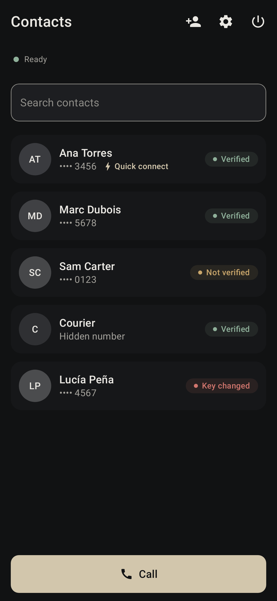
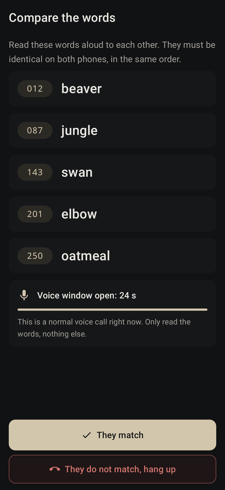
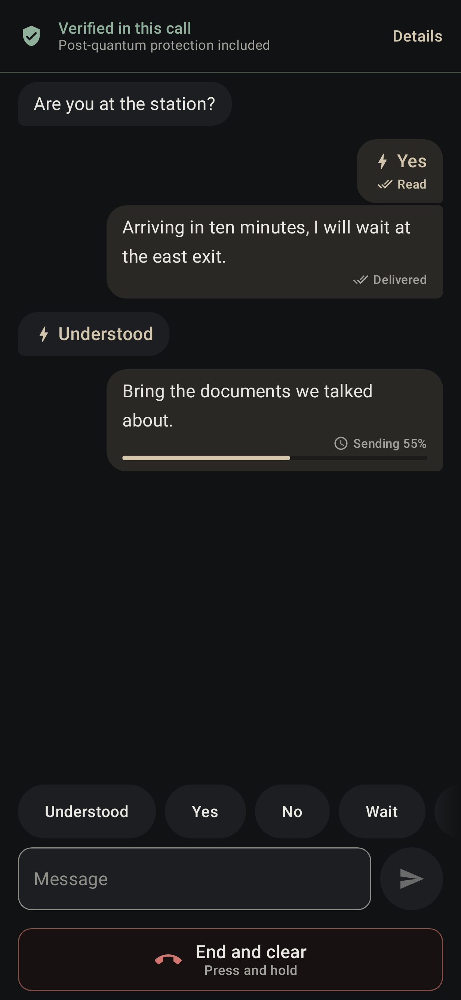
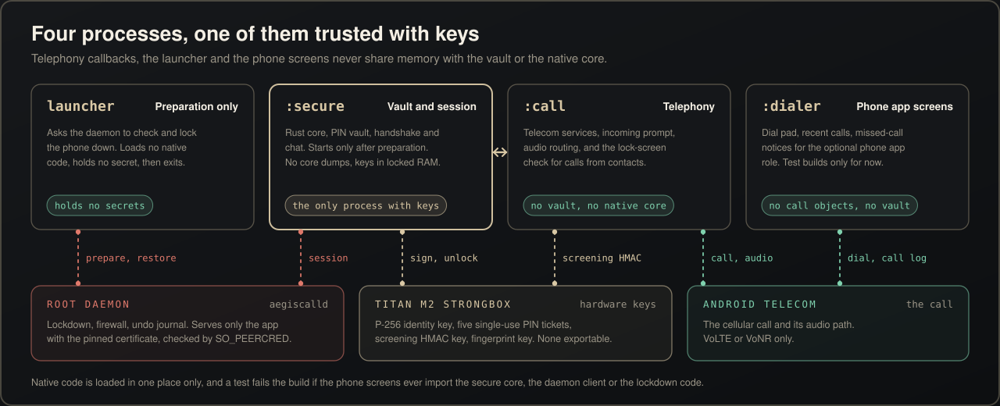

<p align="center">
  
</p>

# DialCrypt — 后量子语音信道数据传输（Post-Quantum Data over Voice）

**通过普通蜂窝语音通话（VoLTE/VoNR）进行的端到端加密文字通讯——无需 `INTERNET` 权限，无服务器，无账号，无云端。**

DialCrypt 是一个开源的**安全通信研究（Secure Communication Research）**项目，探索**无需互联网的加密通讯（Encrypted Messaging without Internet）**：将密文以**语音承载数据（Data over Voice）**的方式，经由两部已获取 root 权限的 Google Pixel 之间的普通**蜂窝语音信道**完成传输。

它结合了从零用 Rust 编写的**语音频带调制解调器（Voice-Band Modem）**、面向 **AMR-WB / EVS 语音编解码器**的**数字信号处理（DSP）**与**前向纠错（FEC）**、**混合后量子密码学**（`X25519 + ML-KEM-1024`）、基于 Titan M2 Android StrongBox 的**硬件级密钥保护**，以及通过 root 封锁守护进程与 **Android 电话音频**进程隔离实现的 **Android 系统安全加固**。

**状态：** Pre-alpha 研究原型。已完成初步双机 VoLTE 实测，独立安全审计尚待进行。

<p align="center">
  <a href="LICENSE"></a>
  
  
  
  
  
</p>

<p align="center">
  <a href="README.md">English</a> · <strong>简体中文</strong>
</p>

> [!WARNING]
> **DialCrypt 是一个 pre-alpha 研究原型。** 它没有经过第三方安全审计，只在两部测试手机之间完成了少量真实的 VoLTE 通话，不得用于保护任何人的人身安全。[当前状态](#当前状态)一节列出了哪些已完成、哪些尚未完成。

<table>
  <tr>
    <td width="25%" valign="top">
      <strong>密文藏在通话的声音里</strong><br>
      当数据网络被封锁、被监视或被关闭时，语音通话依然能够接通。一个用 Rust 写成的调制解调器把封装好的帧变成音调，经过运营商的语音编解码器，搭载在普通的 VoLTE 或 VoNR 通话上。
    </td>
    <td width="25%" valign="top">
      <strong>完全没有网络攻击面</strong><br>
      清单文件中没有声明 <code>INTERNET</code> 权限。在已启用（armed）的会话期间，root 守护进程会关闭各个无线模块，并加载防火墙规则，丢弃除通话自身的信令和媒体之外的一切流量。
    </td>
    <td width="25%" valign="top">
      <strong>后量子，根植于硬件</strong><br>
      <code>X25519 + ML-KEM-1024</code> 密钥协商，在 StrongBox 内部生成的 P-256 身份签名，双方都会校验 Android Key Attestation 证明链。没有 StrongBox，就无法启动：不存在软件回退。
    </td>
    <td width="25%" valign="top">
      <strong>由硅片计数，为被遗忘而生</strong><br>
      五把一次性 StrongBox 密钥强制执行五次尝试的 PIN 码限制，恢复备份也无法将其重置。消息只存在于锁定的内存中，紧急 PIN 码会销毁密钥和保险库。
    </td>
  </tr>
</table>

<p align="center">
  
  
  
</p>

<p align="center"><sub>截图使用测试数据。从左到右：联系人、五词语音核对、已验证的聊天。</sub></p>

<p align="center">
  <a href="https://www.youtube.com/watch?v=YZn9QQuQKfE">
    
  </a>
</p>

<p align="center"><sub>▶ <a href="https://www.youtube.com/watch?v=YZn9QQuQKfE">在 YouTube 上观看演示：DialCrypt – Encrypted Messaging over VoLTE | Rust Modem &amp; Post-Quantum Cryptography</a></sub></p>

## 目录

- [从零自研](#从零自研)
- [一通安全通话如何运作](#一通安全通话如何运作)
- [技术栈](#技术栈)
- [调制解调器：把数据当作语音](#调制解调器把数据当作语音)
- [封锁守护进程](#封锁守护进程)
- [进程隔离](#进程隔离)
- [保险库、紧急 PIN 码与指纹](#保险库紧急-pin-码与指纹)
- [为什么选择 DialCrypt](#为什么选择-dialcrypt)
- [威胁模型与局限](#威胁模型与局限)
- [仓库结构](#仓库结构) · [构建](#构建) · [当前状态](#当前状态) · [开发说明](#开发说明) · [文档](#文档)

## 从零自研

DialCrypt 不是对 WebRTC 或某个即时通讯 SDK 的封装。调制解调器、握手、保险库、守护进程和键盘都是为这个项目专门编写的，使用 Rust 和 Kotlin，因为常见的现成组件都假定存在互联网连接。有八个部分值得细看，每一项都标出了实现它的代码。

**1. 存在于硬件中的 PIN 码限制**（`aegiscall-trust`）

Android 没有给应用提供能在备份恢复后依然保留的计数器，所以攻击者复制一份加密的保险库后，通常可以无限次地猜测。DialCrypt 把保险库封存在五把用 `setMaxUsageCount(1)` 创建的 StrongBox HMAC-SHA256 密钥之下：每把只能签名一次，输错一次 PIN 码就会永久用掉一把。PIN 码先经过 Argon2id 拉伸（64 MiB，3 轮）。输入正确的 PIN 码后，保险库会重新封存在五把全新的密钥之下，并删除旧密钥，因此 `vault.v2` 的每一份旧副本都会失效。普通封装和紧急封装长度与格式相同，按字节排序存放，文件按 4 KiB 块填充。

<p align="center">
  
</p>

**2. 能扛过语音编解码器的调制解调器**（`aegiscall-modem`、`aegiscall-jni/src/audio.rs`）

AMR-WB 和 EVS 是为承载人声而设计的：它们会扭曲相位，压缩一切非语音的内容，并在抖动缓冲区里丢弃或插入采样点，而且两部手机的音频时钟还会彼此漂移。调制解调器逐一应对这些问题。一个 400 ms 的升降扫频（chirp）前导码（600 至 1900 Hz）用来确定帧的时序并估计载波偏移。码率 1/2、K=7 的卷积码配合软判决 Viterbi 解码和 384 位交织器，可吸收突发错误。每个子带都会针对信道的频率倾斜进行补偿，时钟跟踪器会在通话期间拉伸或压缩帧步长；测试套件会在晶振偏差 -116 ppm 和 -200 ppm、缓冲区出现 40 个采样点跳变的条件下运行它。

**3. 形状像人声的数据**（`speech.rs` 中的 `Speech300`）

传统调制解调器发送稳定的导频和机械的嗡嗡声，而这恰恰是语音编解码器的噪声抑制会去掉的东西。`Speech300` 则把它的帧合成为类似人声的波形：音高曲线在每个超帧七个音节内于 102 至 156 Hz 之间移动并具非周期跨句韵律，声门脉冲激励，三个一起滑动的共振峰，七类辅音起始，无状态单帧谐波梳状基频估计器，以及作为前导码的元音滑音。`Robust300` 与 `Speech300` 均可在设置中选用并参与实时通话协商。

**4. 无视来电显示的握手**（`aegiscall-crypto`）

来电显示可以被伪造或隐藏，所以它不决定任何事。拨号方在其 77 字节的 `HS1` 中，为它所拨打的联系人写入盲化标签；应答方用随机字节填充相同的字段，把拨号方的标签与自己保险库中的每一个密钥逐一比对，并在一个 2 字节的 `PATH` 消息中宣告结果，双方在派生任何密钥之前，都会把它哈希进 SHA-384 转录（transcript）。随后是 X25519 和 ML-KEM-1024，以及在 StrongBox 内部生成并经封装的 P-256 身份签名，使线路上看不到双方身份。已验证的联系人通过双槽滚动密钥（`rs_cur`、`rs_new`）重新连接：在一条加密的 `RESUME_SAVED` 帧证明对方已存下新密钥之前，两部手机都不会丢弃旧密钥，所以通话在更新中途掉线，也不会让双方的密钥失去同步。

**5. 在锁定的手机上识别联系人，且不存储号码**（`ScreeningStore`、`ContactNumberIndex`）

通话界面运行在一个无法打开保险库的进程里，但它们必须知道来电者是不是已保存的联系人。它们向一把 StrongBox HMAC 密钥询问，而不是查一份列表：`screen.bin` 始终是 32,004 字节，1,000 个槽位里填的要么是带密钥的标签，要么是随机字节，所以这个文件既不显示号码，也不显示联系人有多少。第二个索引只保存每个号码末尾几位数字的 HMAC 中的 20 位，足以在通话界面上遮蔽联系人的号码，却远不足以从文件中列出联系人。

**6. 只给通话留一条路的防火墙**（`aegiscalld`）

切断所有网络会让 VoLTE 失效；放行整个 IMS 接口则会留下侧信道。守护进程通过 `SO_PEERCRED` 和固定（pinned）的签名证书识别调用方，写入一份经过 fsync 的撤销日志，每一行都带 CRC32，然后关闭 Wi-Fi、移动数据、蓝牙、NFC、UWB 和 USB 数据，把基带限制在 LTE 和 NR，并加载 `iptables` 和 `ip6tables` 规则，这些规则放行回环、IPv6 邻居发现、发往当前 P-CSCF 的 IMS 流量，以及最多四个媒体端点，而这些端点只在通话建立期间通过 `NFLOG` 学习得到。其余一切都被丢弃。

**7. 让系统够不着的机密**（`aegiscall-memsec`、`SecureInput`）

Android 会把空闲内存压缩进 `zram`，Java 字符串也会在垃圾回收器处理它们之前一直留着。会话密钥和消息保存在 Rust 缓冲区中，这些缓冲区被锁定在内存里（`mlock`），被排除在转储之外（`MADV_DONTDUMP`、`PR_SET_DUMPABLE=0`），并在释放时清零。文字在应用自带的键盘上输入，所以不会经过任何系统输入法，PIN 码键盘在每次输入时都会重新打乱，PIN 码只以 `CharArray` 和 `ByteArray` 缓冲区的形式处理，并在 `finally` 块中清除，绝不会成为 `String`。

**8. 不含任何机密的配对名片，装在扫得出来的二维码里**（`pairing_v2.rs`、`QrCode.kt`）

一个配对码是 68 字节：一个版本号、P-256 身份密钥、一个 X25519 配对密钥和一个 CRC。两个联系人通过各自名片之间的 X25519 交换来派生配对密钥（pairing secret），所以即使有人拿到了两张二维码的照片，或者拿到了传送过这两张名片的应用，也无法算出它。二维码编码器是纯 Kotlin 实现，它会拒绝任何数据区恰好含有扫描器会误认作定位图案的掩码：没有这项检查时，在测试中最多每八张邀请名片就有一张无法解码。

## 一通安全通话如何运作

<p align="center">
  
</p>

1. **准备与加固。** 打开应用（它在桌面上的名称是“备忘录”）。在加载任何原生代码或机密之前，启动器会请求 root 守护进程检查手机并将其锁定。然后你在打乱顺序的键盘上用 PIN 码解锁保险库。
2. **拨号。** 一通普通的电话，只走 VoLTE 或 VoNR。VoWiFi、2G 和 3G 都会被拒绝。如果对方手机的前导码在 20 秒内没有到达，通话就会被挂断。
3. **以声音完成握手。** 两部手机以调制解调器音调的形式交换承诺、X25519 与 ML-KEM-1024 的密钥协商，以及由 StrongBox 签名的身份，并相互校验对方的 Android Key Attestation 证明链。握手有严格的时间上限：默认档位下为 90 秒。
4. **读出验证词。** 对于新联系人，或者已保存联系人的密钥发生了变化时，双方都会打开一个限时的语音窗口，大声读出五个词：40 位，与先发送的承诺绑定。如果两边的词不一样，就不要信任这通电话。
5. **加密聊天。** 纯文本和快捷回复（是、否、明白了、请稍等等）以封装好的 23 字节超帧形式，经选择性重传（selective-repeat）ARQ 传送。每 375 帧，全新的 X25519 棘轮步骤就会更换一次密钥。不发送任何媒体。
6. **结束并清除。** 会话结束，消息从锁定的内存中抹除，这通电话的条目被从手机的通话记录中移除（尽力而为），守护进程根据它的日志恢复系统。

<p align="center">
  
</p>

途中任何一步失败，通话都会结束。不存在降级到未加密模式的做法，同一通电话上也不会重试。你验证过一次的联系人可以快速重新连接（快速连接）；后量子交换随后在通话接通之后于后台完成，在它完成之前，屏幕不会声称已有后量子保护。没有与你配对过的人仍然可以打来电话，但在你们核对验证词之前，聊天会被标记为**未验证**。

**接听。** 来自已保存联系人的来电会在锁屏上方显示一个提示：安全接听、作为普通通话接听，或者拒接。安全接听需要保险库，所以它会要求输入 PIN 码，或者在你开启了指纹时要求指纹。任何人拿起你的手机而没有 PIN 码，都只能把这通电话当作普通通话接听：来电者的麦克风保持静音，不会建立安全会话，来电者的手机在 20 秒收不到前导码后就会挂断。

## 技术栈

| 层 | DialCrypt 使用的方案 |
|---|---|
| 密钥协商 | 混合交换：X25519 加 ML-KEM-1024（FIPS 203）。握手消息：`HS1` 77 B，`PATH` 2 B，`HS2` 1,600 B，`HS3` 1,729 B，`HS4` 129 B |
| 认证 | 基于承诺的 SAS：在限时语音窗口中大声读出五个词（40 位）。在 StrongBox 内部生成并以封装形式发送的 SIGMA 风格 P-256 身份签名。校验 Android Key Attestation 证明链 |
| 密钥派生与完整性 | 基于持续累积的转录哈希，使用 SHA-384 的 HKDF 和 HMAC |
| 消息加密 | XChaCha20 加 Poly1305 标签（每个 23 字节超帧在线路上带 48 位），配合逐超帧对称 KDF 链式棘轮、单次消息密钥即时销毁与每轮伪造计数上限 |
| 重新协商密钥 | 每 375 帧一次 X25519 DH 棘轮（或累计 64 次验签失败后提前触发）；密钥使用超过 1,875 帧的会话会被结束 |
| 快速重连 | 已验证联系人通过双槽滚动密钥快速连接（PSK 延续后量子机密性），ML-KEM-1024 在后台补入；连续 3 通快速连接未完成后台 ML-KEM-1024 刷新时强制回退至完整后量子握手 |
| 硬件 | 身份密钥、PIN 码票据、筛查密钥和指纹密钥只保存在 StrongBox（Titan M2）中。如果 StrongBox 不可用，应用拒绝启动 |
| 保险库 | Argon2id（64 MiB，3 轮）、五个一次性 StrongBox 票据、ChaCha20-Poly1305、4 KiB 填充。PIN 码至少 10 个字符 |
| 内存 | 消息只存在于内存中：`mlock`、`MADV_DONTDUMP`、`PR_SET_DUMPABLE=0` 和清零（`aegiscall-memsec`） |
| 配对 | 68 字节的配对码（前缀 `AEGIS2-`）或二维码邀请名片（`AEGISCARD1:`）。配对密钥来自两张名片之间的 X25519 交换。二维码编码器是纯 Kotlin 实现，扫描到的画面只在内存中解码 |
| 失败策略 | 处处故障关闭（fail-closed）：握手中止、20 秒内没有对方前导码、链路停滞，或任何校验失败，都会挂断 |
| 依赖 | `deny.toml` 把依赖的许可证限制为宽松许可证，由 cargo-deny 强制执行 |
| 测试 | 431 项 Rust 测试和 758 项 Android 单元测试，外加针对握手和配对解析器的模糊测试（`core/aegiscall-crypto/tests/fuzz_*.rs`、`core/aegiscall-chat/tests/fuzz_hs_link.rs`）。这些数字是清单统计，不是通过报告 |
| 计划中 | ML-DSA-65 硬件后量子身份签名：设计已定，尚未实现任何内容（[设计文档](docs/design/pq-identity-signature.md)） |

## 调制解调器：把数据当作语音

蜂窝语音信道与语音编解码器（AMR-WB、EVS、AMR-NB）是为承载人类语音而建的，它们会压缩或抑制非语音信号。DialCrypt 的 Rust 语音频带调制解调器（`core/aegiscall-modem`）专门围绕语音承载数据（Data over Voice）与数字信号处理（DSP）而设计：20 ms 编解码器帧对齐、定重多音码本、码率 1/2 K=7 前向纠错（FEC）与软判决 Viterbi 解码、扫频前导码同步与载波频偏（CFO）估计、判决引导的接收端信道补偿、采样时钟漂移跟踪、选择性重传 ARQ，以及恒定速率超帧复用（`core/aegiscall-mux`）。它有四个档位（[`modulator.rs`](core/aegiscall-modem/src/modulator.rs)）。其中两个目前在通话中使用；另外两个存在于调制解调器 crate 和实验室工具中，尚未在通话中协商使用。

完整的 DSP 参数、码本设计、FEC 与交织器结构、前导码 CFO 算法、时钟漂移跟踪以及实验室工具命令，请见独立技术文档 [docs/design/modem.md](docs/design/modem.md)（英文）。

<p align="center">
  
</p>

| 档位 | 原始速率 | 净速率 | 通话中使用 | 设计 |
|---|---|---|---|---|
| `Wideband2400` | 2,400 bps | 约 1,150 bps | 是，默认 | 在 500 至 6437.5 Hz 内的 12 个子带，每个子带 7 选 2 音调，面向宽带 VoLTE 编解码器（AMR-WB、EVS）。超帧 8 帧，160 ms |
| `Narrowband1200` | 1,200 bps | 约 575 bps | 是 | 在 500 至 3062.5 Hz 内的 6 个子带，每个子带 6 选 3 音调，旨在扛过窄带编解码器（AMR-NB）。超帧 16 帧，320 ms |
| `Robust300` | 300 bps | 约 144 bps | 是（可选） | 在 500 至 1875 Hz 内、125 Hz 栅格上的 3 个子带，每个子带 4 选 1 音调，为编解码器负担很重的路径而设，这类路径会丢弃同时出现的音调，并在约 2 kHz 以上衰减。超帧 64 帧，1.28 s |
| `Speech300` | 300 bps | 约 144 bps | 是（可选） | 把数据承载为合成的、类似人声的波形（见[从零自研](#从零自研)第 3 项） |

在约 144 bps 的速率下，一条信道每秒大约传送 18 字节。这足够传短文本和快捷回复，也正是 DialCrypt 不传其他任何东西的原因。

你可以听到这些档位：[`tools/gv-probe/captures/speech-comparison`](tools/gv-probe/captures/README.md#speech-comparison) 里有五段生成的短样本，两段来自音调档位，三段来自 Speech300。

**已测得的结果。** 2026-11-23，调制解调器在一通真实通话上做了测试：用 Google Voice 拨打一部 Pixel 9 的 Wi-Fi 通话号码。信道探测显示，在这条路径上音调增益在 500 Hz 为 +6 dB，在 2 kHz 为 -8 dB，在 3 kHz 为 -14 dB。

| 档位 | 解码的帧数 | FEC 之前的误码率 |
|---|---|---|
| Robust | 17 / 18 | 2.65% |
| Narrow | 3 / 24 | 20.28% |
| Wide | 0 / 30 | 32.73% |

这只是一条路径、一天的结果。它说明了为什么需要一个稳健档位，也说明在这条特定路径上，更快的档位表现要差得多。原始录音和命令在 [`tools/gv-probe/captures`](tools/gv-probe/captures/README.md) 中。

**VoLTE 端到端。** 2026-11-24，一部 Pixel 7 在商用 VoLTE 网络上呼叫了一部 Pixel 7a（两端都在 LTE 上，AMR-WB，没有 RTP 包丢失）。这个联系人在更早的一通电话中已经用五词核对验证过，所以应用使用了快速连接：接听后约 20 秒，安全聊天就打开了；大约一分钟后，后台的后量子交换达到“已包含”；两个方向各送达了一条快捷回复，“结束并清除”让两部手机都挂断了。守护进程处于演练模式（`armed=0`），所以没有实际运行锁定功能，使用的调制解调器档位也没有记录。这两部手机运行的是 DialCrypt 更名之前的 0.1.0 版本构建。

## 封锁守护进程

在安全会话进行期间，一个以 root 身份运行的 Rust 守护进程（`aegiscalld`）会锁定手机。它由一个 Magisk 模块安装（[构建说明](magisk-module/BUILD.md)）。

<p align="center">
  
</p>

| 级别 | 状态 | 作用 |
|---|---|---|
| 1 | 默认开启 | 先写入恢复日志，然后关闭 Wi-Fi、移动数据、蓝牙、NFC、UWB 和后台扫描，把 USB 设为仅充电，让基带只留在 LTE 和 NR，并加载防火墙规则，丢弃除回环、IPv6 邻居发现、发往 P-CSCF 的 IMS 流量以及最多四个学到的媒体端点之外的一切 |
| 2 | 默认关闭，尚未在设备上验证 | 挂起其他应用、第三方输入法和无障碍服务，并清理内存。通过 `dedicated_mode=1` 启用 |

守护进程以演练模式启动。只有在 `/data/adb/aegischat/policy.conf` 中设置 `armed=1` 之后，它才会更改系统；并且在应用的签名证书哈希被固定在那里之前，它会拒绝所有连接。会话结束时、守护进程死掉时，或者开机时，系统都会根据日志恢复；最后这种情形由 Magisk 模块附带的开机恢复脚本负责。

## 进程隔离

<p align="center">
  
</p>

应用以四个进程运行，使电话回调和输入界面永远不会与密钥材料共享内存。启动器只负责准备，然后退出。`:call` 持有 Telecom 服务、来电提示和音频路由。`:dialer` 持有可选的默认电话应用的界面。只有 `:secure` 会加载原生核心并打开保险库，而且只有在守护进程的准备成功之后才会启动。

## 保险库、紧急 PIN 码与指纹

- **PIN 码保险库。** 联系人、配对数据和快速重连密钥都在你的 PIN 码和 StrongBox 票据之后。连续输错五次 PIN 码，保险库就会永久失效。
- **紧急 PIN 码。** 输入它会销毁密钥和保险库，并关闭应用。
- **指纹接听（可选，默认关闭）。** 指纹可以为一通正在响铃的安全来电解锁应用，这样你在输入 PIN 码的时候不会错过电话。它只对这一通电话有效：通话结束，或者在接起之前就不再响铃时，应用会重新锁定，在此之前，联系人、配对和设置都无法更改。重启之后、距上次输入 PIN 码 12 小时之后、任何一次输错 PIN 码之后，以及手机上的指纹发生变化时，仍然需要 PIN 码。指纹解锁绝不会返还输错 PIN 码所消耗的尝试次数。参见 [docs/design/fingerprint-answer.md](docs/design/fingerprint-answer.md)。
- **在应用内更改 PIN 码。** 更改 PIN 码或紧急 PIN 码时，会先要求输入当前 PIN 码，用新的盐值和五把全新的票据重新封存保险库，并关闭指纹接听，直到你再次启用。连续三次输错当前 PIN 码会锁定应用，紧急 PIN 码在该输入框里同样有效。
- **自动重新锁定。** 离开应用就会锁定它，在屏幕关闭或另一个应用位于前台时结束的通话也会锁定它。在应用内，五分钟没有触摸就会锁定，通话正在响铃、正在建立或正在进行时除外；已结束通话的界面按空闲计算。
- **屏幕上的号码。** 不是联系人的来电者会显示完整号码。联系人的号码只显示末四位数字，除非你开启“显示联系人的完整号码”。
- **打乱顺序的键盘。** 输入 PIN 码时按键位置是随机的，所以你的手指落在哪里泄露的信息更少。
- **消息从不落盘。** 它们只存在于锁定的内存中。
- **看起来像备忘录。** 桌面上的名称是“备忘录”，窗口带有 `FLAG_SECURE` 标记，所以截屏会被阻止。
- **自带键盘。** 使用内置的拉丁字母键盘，所以文字从不经过系统输入法。界面提供英语（默认）、西班牙语、法语和简体中文。
- **默认电话应用（测试版本）。** DialCrypt 可以接管电话应用的角色，并自己绘制通话界面：来电和通话中界面、拨号盘、最近通话、挂断和接听、合并通话。在设备上验证之前，发布版本会让这些组件保持关闭（[设计文档](docs/design/default-dialer-v1.md)）。

## 为什么选择 DialCrypt

成熟的端到端加密通讯软件速度快、经过审计，只要你有可用的互联网连接，它们就是正确的选择。DialCrypt 探索的是另一个问题：如果应用根本不被允许接触互联网，会怎样？

| | 基于互联网的端到端加密通讯软件 | DialCrypt |
|---|---|---|
| 成熟度 | 成熟，被广泛审查，有些经过独立审计 | pre-alpha 研究原型，没有第三方审计 |
| 传输 | 经由服务方服务器的 IP 数据 | 两部手机之间语音通话的音频。没有服务器、中继或账号 |
| 速度与功能 | 速度快，支持媒体、群组和通话 | 通话中净速率约 575 至 1,150 bps，只支持纯文本和快捷回复 |
| 应用的网络访问 | 需要 `INTERNET` 权限和可到达的基础设施 | 没有网络权限；在已启用的会话期间，防火墙丢弃除通话之外的一切 |
| 设备 | 大多数手机和桌面设备 | 仅限带有 StrongBox 的 Google Pixel（Android 14 及更高版本，arm64），并用 Magisk 获取 root |
| 元数据 | 取决于服务方 | 没有隐藏：运营商仍能看到谁在什么时候、从哪个基站呼叫了谁 |

## 威胁模型与局限

| 威胁 | DialCrypt 的做法 | 局限 |
|---|---|---|
| 运营商或基站记录通话 | 通话上只有加密的调制解调器音频。密钥交换混入了 ML-KEM-1024 | 快速连接（`Resume`）在后台 ML-KEM-1024 补入完成前依赖上一通握手延续的对称恢复密钥维持后量子机密性；若连续 3 通快速连接未完成后台补入，下一次将强制执行完整 ML-KEM-1024 握手 |
| 主动中间人、伪造或篡改的数据包 | AEAD 帧认证、基于承诺的 SAS、StrongBox 身份签名、证明链校验 | 在你们核对验证词之前，未配对的联系人始终只是**未验证** |
| 手机事后被扣押 | 消息只存在于内存中。保险库由 PIN 码和一次性 StrongBox 凭据保护，输错 5 次后即失效。紧急 PIN 码会销毁密钥 | 在装有 Magisk 的设备上，其他 root 软件仍可能读取进程内存 |
| 被强迫用指纹解锁 | 指纹接听默认关闭，并且只为正在响铃的那通安全来电打开应用；重启、12 小时、输错 PIN 码或指纹变化都会让 PIN 码回来 | 一旦你开启了指纹接听，有人在安全来电响铃期间强行把你的手指按在传感器上，就能得到这通电话：你的紧急 PIN 码保护不了它。指纹接听绝不会返还输错 PIN 码所消耗的次数：在它之后，只有它所用的那一张票据被替换。12 小时规则和输错 PIN 码规则依赖一个普通文件（`bio_fresh.bin`），root 软件可以恢复或改写它，所以在已 root 的手机上这些规则并不成立。尝试次数限制不依赖该文件，并且能抵御被恢复的文件，但能以应用的身份创建 Keystore 条目的 root 软件同样可以击败它 |
| 解锁状态下手机上的 root 软件 | 身份密钥保存在 StrongBox 中，只有在手机解锁时才能使用 | 身份密钥绑定的是手机处于解锁状态，而不是应用的 PIN 码。已 root 且已解锁的手机上的 root 软件，可以让握手被签名，并向你只用验证词验证过的联系人冒充你；与你持有配对密钥的联系人会拒绝这样的通话 |
| 使用期间其他应用或网络的干扰 | root 守护进程的两级加固 | 级别 2 默认关闭，尚未在设备上验证。级别 1 不会阻止其他应用，IMS 服务仍然可以与 P-CSCF 以及它学到的媒体地址通信 |
| 截屏与旁观者 | `FLAG_SECURE`、打乱顺序的 PIN 码键盘、备忘录这一桌面名称。列表和通话界面只显示联系人号码的末四位，除非你开启“显示联系人的完整号码”，而在锁屏上则始终如此。不是联系人的号码会完整显示，在锁屏上也一样。当应用无法判断时（没有可读的索引、缺少密钥、开机后第一次解锁之前），该号码按联系人处理 | 在设置中，DialCrypt 可以成为默认电话应用，自己绘制通话界面并遮蔽号码。这只在测试版本中提供，尚未在设备上验证；发布版本会自行禁用电话应用组件，所以 Android 无法把 DialCrypt 提供为电话应用。它关闭时，手机自带的拨号器仍会在它的来电界面和通知中显示完整号码 |
| 无障碍服务读取屏幕 | 只要有任何无障碍服务处于开启状态，准备就会失败并给出明确的原因，所以会话永远不会在开着无障碍服务的情况下启动 | 级别 1 不会自行关闭无障碍服务；你必须在系统设置中自己关闭。应用只在准备开始时检查一次：会话中途才打开的服务不会被发现，root 软件仍然可以读取屏幕 |
| 有人在屏幕解锁时使用手机 | 联系人的电话号码、互相添加标记和配对种子保存在 `contact_meta.bin` 中，用一把存在于 PIN 码保险库内部的密钥封存。只有在应用 PIN 码解锁保险库之后才能读取它们，锁定应用会把它们从内存中清除 | 应用处于解锁状态时，它们位于应用内存中，root 软件可以读取 |
| 有人读取联系人号码索引 | 为了让通话界面在保险库锁定时也能区分联系人，`number_index.bin` 只保存每个联系人号码后 8 位数字的 HMAC-SHA256 的前 20 位（国内号码部分不足 8 位的号码另有第二个尾号），用随机标签填充到 64 的倍数并排序。按尾号匹配时，一个号码无论怎么书写、无论使用哪张 SIM 卡，答案都相同。HMAC 密钥保存在 Android Keystore 中（有 StrongBox 时在 StrongBox 中），无法导出。每一次保险库清除，包括紧急 PIN 码，都会删除该文件和该密钥 | 拿到该文件并且能在手机上使用那把 Keystore 密钥的人（例如开机后首次解锁之后的 root 软件），可以检查一个他们已知的号码是不是联系人。把全部 1 亿个 8 位尾号都送进该密钥运算，他们还能把每个标签缩小到约 95 个候选尾号（10^8 / 2^20），而无法得知哪些标签是填充物：一个有 64 个标签的文件会留下约 6,100 个候选尾号，而尾号前面的数字仍然未知。陌生人的号码在其后 8 位与某个联系人相同时会显示为遮蔽，凭巧合出现这种情况的概率约为百万分之 N，其中 N 是填充后的标签数。文件的大小显示的是向上取整到 64 的倍数的尾号数量。国内号码少于 8 位的联系人，在手机装有另一个国家的 SIM 卡时，其短的本地形式不会被识别，于是会完整显示；没有任何 SIM 卡所在国家时，这样的短本地号码会显示为遮蔽 |
| 通过配对码关联通话 | 配对码只含有你的身份密钥和一个公开的 X25519 配对密钥。每一对联系人通过他们两个配对密钥之间的 X25519 交换来派生各自的 `psk`，该 `psk` 在完整握手时认证已配对的联系人。双方共同的第三个联系人、两张二维码的照片，或传送过这两张名片的应用，都无法算出它，所以它们无法识别这两人之间的通话 | 拥有量子计算机且持有双方名片的人，可以算出 `psk` 并识别他们的通话。如果被扣押的手机泄露了 `contact_meta.bin` 中的配对种子，那么与攻击者持有名片的任何人之间的 `psk` 都可以被算出，包括已删除的联系人。在你生成新的码之后，请与每个联系人重新扫描名片：在任意一方导入变更之后生成的名片之前，通话继续可用，此后它们会停止并要求重新扫描，直到双方都导入了对方当前的名片。带有已保存联系人的身份密钥但配对密钥不同的名片，会被显示为对该联系人配对的替换，在你确认之前不会写入任何内容。如果有人诱骗你扫描这样的名片并确认，你与该联系人之间的配对密钥就不再匹配，与他们的安全通话会停止，直到你们再次互相扫描对方的名片；这张名片不能用来冒充该联系人，因为通话仍然需要他们的身份密钥。回复名片不含任何机密，所以见过你名片的人可以伪造一张回复名片；如果你确认了替换，该联系人会在双方显示为已添加，但下一次完整握手会停止并要求重新扫描，而且这张伪造的名片无法冒充该联系人 |
| 电信元数据 | 无 | 谁在什么时候呼叫了谁、使用了哪个基站，都没有被隐藏 |
| 手机上的系统通话记录 | 在应用发出或安全接听的每通电话之后，以及在来自已保存安全联系人的每通电话之后（无论哪种方式接听、未接或拒接），它都会尽力从手机的通话记录中删除对应的条目。它需要 `WRITE_CALL_LOG`，由 Magisk 模块授予 | 运营商的通话记录和账单不在保护范围内，条目在被删除之前的那几秒钟也不在。尚未在设备上验证 |
| 启动链 | 无 | Magisk 需要解锁的引导加载程序，这会破坏经过验证的启动链。参见 [SECURITY-RELOCK-GUIDE.md](SECURITY-RELOCK-GUIDE.md) |
| 紧急呼叫 | 无 | 手机被限制在 LTE 和 NR 时，在不支持 VoLTE 紧急呼叫的网络上，紧急呼叫可能失败 |
| 独立审查 | 无 | 没有第三方安全审计，也没有认证 |

完整列表见 [docs/design/secure-session-v2.md](docs/design/secure-session-v2.md) 第 6.10 节。

## 仓库结构

应用是 DialCrypt，包名 `io.github.h4lovoid.dialcrypt`。Rust crate、守护进程及其设备上的路径沿用项目的工作名称（`aegiscall-*`、`aegiscalld`、`/data/adb/aegischat`），协议标签保留它们的 `Aegis` 前缀。

```text
.
|-- core/
|   |-- aegiscall-memsec/    锁定内存与清零
|   |-- aegiscall-modem/     语音频带调制解调器：调制、解调、FEC、前导码、信道模拟器
|   |-- aegiscall-crypto/    握手 v2、恢复、DH 棘轮、AEAD
|   |-- aegiscall-trust/     PIN 码保险库、证明链校验
|   |-- aegiscall-mux/       超帧调度（控制、聊天、批量、填充）
|   |-- aegiscall-chat/      分片、选择性重传 ARQ、握手链路层、通话会话
|   '-- aegiscall-jni/       Android JNI 桥
|-- daemon/                  aegiscalld：root 封锁守护进程
|-- magisk-module/           Magisk 模块：守护进程安装和开机恢复脚本
|-- app/                     Android 应用（Kotlin、Jetpack Compose），单一 flavor pixelTitan
|-- tools/
|   |-- android-build/       build.sh：JNI 库、守护进程、APK 和模块 zip
|   |-- gv-probe/            真实通话测试辅助工具和录制的捕获数据
|   '-- modem-wav/           调制解调器 WAV 生成器和分析器
'-- docs/
    |-- design/              设计文档
    '-- ui-preview/          截图（测试数据）
```

应用面向 Android minSdk 34 和 targetSdk 35，运行于 arm64-v8a，界面使用 Jetpack Compose。

## 构建

在开发机器上运行 Rust 检查：

```sh
cargo test --workspace
cargo deny check licenses bans sources
```

用辅助脚本构建 Android 部分。它需要 cargo-ndk、`ANDROID_HOME` 和 `ANDROID_NDK_HOME`（完整的工具集和步骤请阅读 [`tools/android-build/build.sh`](tools/android-build/build.sh) 和 [`magisk-module/BUILD.md`](magisk-module/BUILD.md)）。它会构建 JNI 库、守护进程、发布版 APK 和 Magisk 模块 zip，并用保存在仓库之外的测试密钥签名：

```sh
bash tools/android-build/build.sh
./gradlew assemblePixelTitanRelease
```

Gradle 不会编译 Rust JNI 库。如果你没有先构建它就运行 Gradle，应用会打开并显示**安全核心未连接**。

测试开关 `AEGIS_TEST_NO_PIN=1`（内置一个测试 PIN 码并跳过 PIN 码输入）和 `AEGIS_FIELD_TEST=1`（现场测试密钥库和线路探测路径）只在单独的 `fieldTest` 构建类型中生效，该类型使用发布版的代码和签名，并在版本名称中加上 `-fieldtest`。发布构建始终将它们关闭，而且只要其中任何一个变量被设置，Gradle 就会拒绝组装或打包 `pixelTitanRelease`。只要设置了其中任何一个变量，`build.sh` 就会构建 `assemblePixelTitanFieldTest` 并写出 `out/aegischat-module-FIELDTEST.zip`：

```sh
AEGIS_FIELD_TEST=1 bash tools/android-build/build.sh
./gradlew assemblePixelTitanFieldTest
```

> 切勿把现场测试构建安装在你打算真正使用的手机上。

## 当前状态

已完成：

- Rust 核心：握手 v2 与恢复、DH 棘轮、PIN 码保险库、证明链校验、复用器、聊天层、调制解调器。
- JNI 桥、root 守护进程和 Magisk 模块脚本。
- 四种语言的 Jetpack Compose 界面。
- 发布构建已接入真实核心（`NativeSecureCore`、`RelayCallLink`、`TitanM2StrongBoxBridge`、`DaemonLockdownController`）。
- 通过 X25519 配对密钥配对、可选的指纹接听、应用内更改 PIN 码、自动重新锁定，以及默认电话应用的界面（仅限测试版本）。

尚未完成，或尚未验证：

- 跨运营商的重复 VoLTE 通话，以及 VoLTE 路径的误码率和档位。在一家运营商上，一通快速连接的通话已经端到端跑通（见[调制解调器](#调制解调器把数据当作语音)）。
- 在守护进程已启用（`armed=1`）时进行安全通话，让封锁在真实通话期间运行。
- Gradle 不会构建 Rust JNI 库；请先运行 `tools/android-build/build.sh`，否则应用会显示“安全核心未连接”。
- 守护进程调用的 Android 系统命令的格式仍需在设备上确认。
- 默认电话应用、指纹接听、PIN 码更改和联系人号码索引都还没有在设备上运行过。它们的设备检查清单在设计文档中。
- `Robust300` 和 `Speech300` 尚未在通话中协商使用。
- 级别 2 加固尚未在设备上验证。
- Magisk 模块尚未在设备上完全验证。
- 没有第三方安全审计。
- ML-DSA-65 身份签名已有设计但尚未实现。

## 开发说明

DialCrypt 的首个研究原型历时约两天完成，作为一项独立的安全通信研究项目，探索蜂窝语音信道、数字信号处理（DSP）、Android 电话音频底层机制以及硬件级密码学。

目前项目重心已转向真实跨设备与跨运营商的 VoLTE/VoNR 验证、语音频带调制解调器稳定性优化、协议与 Android 系统安全加固，以及独立安全审计。

## 文档

| 文档 | 内容 |
|---|---|
| [语音频带调制解调器架构（英文）](docs/design/modem.md) | Data over Voice DSP 设计：四档调制解调器、FEC 与交织器、V-Chirp / 元音滑音前导码、自适应均衡、时钟漂移跟踪与实测记录 |
| [安全会话 v2](docs/design/secure-session-v2.md) | 握手、信任模型和生命周期。第 6 节是已定稿的设计 |
| [后量子身份签名](docs/design/pq-identity-signature.md) | ML-DSA-65 硬件身份签名设计（尚未实现） |
| [来电 v1](docs/design/incoming-call-v1.md) | 来电处理、通话期间的前台显示和安全退出 |
| [默认电话应用 v1](docs/design/default-dialer-v1.md) | 可选的电话应用角色：通话界面、拨号盘、最近通话，以及需要在设备上进行的检查 |
| [指纹接听](docs/design/fingerprint-answer.md) | 可选指纹接听的关键参数、文件格式、生命周期和局限 |
| [SECURITY-RELOCK-GUIDE.md](SECURITY-RELOCK-GUIDE.md) | 解锁引导加载程序的取舍与重新锁定 |
| [magisk-module/BUILD.md](magisk-module/BUILD.md) | 打包 Magisk 模块以及所需的 policy.conf 条目 |

## 安全

如何报告漏洞以及项目的安全策略，请见 [SECURITY.md](SECURITY.md)。

## 法律与负责任的使用

关于加密通信、root 和解锁设备、在运营商网络上运行的规定，各国各不相同，你有责任遵守适用于你的那些规定。DialCrypt 是研究原型，不提供任何担保。使用之前请阅读 [LEGAL.md](LEGAL.md)。

## 许可证

Copyright 2026 h4lo-void。DialCrypt 依据 [GNU General Public License v3.0 only](LICENSE)（GPL-3.0-only）发布。

- [LICENSE](LICENSE)：完整的许可证文本
- [NOTICE.md](NOTICE.md)：第三方声明
- [CONTRIBUTING.md](CONTRIBUTING.md)：如何参与贡献

源代码：<https://github.com/h4lo-void/DialCrypt>
