# Voice-Band Modem Architecture (Data over Voice)

This document specifies the acoustic / voice-band data-over-voice modem implemented in [`core/aegiscall-modem`](../../core/aegiscall-modem), its constant-rate superframe multiplexer in [`core/aegiscall-mux`](../../core/aegiscall-mux), and the streaming synchronization and sample clock-skew tracker in [`core/aegiscall-jni/src/audio.rs`](../../core/aegiscall-jni/src/audio.rs).

> **Scope & status:** Two tone gears (`Wideband2400` and `Narrowband1200`) run in live VoLTE/VoNR calls today. Two 300 bps gears (`Robust300` and `Speech300`) are implemented and unit-tested in the modem crate and `tools/modem-wav`, and are not yet negotiated by the session layer.

---

## 1. Design Constraints of Cellular Voice Channels

Ordinary cellular voice calls (VoLTE / VoNR using AMR-WB or EVS, and legacy or bridged paths using AMR-NB or G.711) are optimized for human speech, not arbitrary binary modems:

- **Perceptual speech coding (CELP / ACELP):** Speech codecs discard phase information, aggressively attenuate non-speech spectral shapes, and distort frequencies above ~3.4 kHz (narrowband) or ~6.5–7.0 kHz (wideband).
- **Noise suppression, AGC, and VAD/DTX:** Carrier and handset DSP pipelines attenuate steady narrowband tones, swing audio gain rapidly, and mute silent intervals via Voice Activity Detection / Discontinuous Transmission (DTX).
- **Packet loss and jitter buffers:** RTP packets arrive in 20 ms frames; VoLTE jitter buffers drop or insert samples asynchronously.
- **Clock skew and frequency offset:** Two phones' audio crystals drift relative to one another (measured at roughly `-116 ppm` between two Pixel test devices), and carrier transcoding can introduce carrier/frequency offset (CFO).

DialCrypt's modem (`FormantGuard`) addresses these constraints across six layers: codec-aligned framing, non-coherent constant-weight multi-tone (or formant pseudo-speech) modulation, soft-decision convolutional FEC with deep block interleaving, chirp/vowel-glide preamble synchronization, decision-directed receiver compensation, and continuous chaff multiplexing.

<p align="center">
  
</p>

---

## 2. Audio Frame Geometry & Superframe Format

All modem gears share the same PCM audio format and 23-byte wire superframe (`core/aegiscall-modem/src/modulator.rs`, `fec.rs`):

| Parameter | Constant | Value | Notes |
|---|---|---|---|
| Sample rate | `SAMPLE_RATE` | `16,000 Hz` | 16-bit signed mono PCM (`i16`) |
| Codec frame length | `FRAME_SAMPLES` | `320 samples` (`20 ms`) | Aligned to AMR-WB / EVS / AMR-NB frame cadence |
| Active DFT window | `DFT_WINDOW_SAMPLES` | `256 samples` (`16 ms`) | Inner core yielding `BIN_HZ = 62.5 Hz` bin spacing |
| Guard edges | `GUARD_EDGE_SAMPLES` | `32 samples` (`2 ms`) each side | Raised-cosine fade-in/out preventing inter-frame clicks and ISI |
| Tone-gear pilot | `PILOT_BIN` / `PILOT_FREQ_HZ` | Bin `6` (`375.0 Hz`) | Continuous pilot for AFC and frame-erasure detection (not used in `Speech300`) |
| Wire superframe payload | `SUPERFRAME_BYTES` | `23 bytes` (`184 bits`) | Encrypted superframe (ciphertext + 48-bit Poly1305 AEAD tag) |
| Pre-FEC block | `PRE_FEC_BITS` | `192 bits` | `184` data bits + `2` zero pad bits + `6` zero tail bits |
| Coded superframe | `CODED_BITS` | `384 bits` | Rate-1/2 convolutional output distributed across one superframe |

---

## 3. Modem Gears

Four gears trade raw throughput against speech-codec resilience (`ModemGear` in `core/aegiscall-modem/src/modulator.rs`):

<p align="center">
  
</p>

| Gear | Wire ID | Raw / Net Rate | Frames / Superframe | Bits / Frame | Subbands & Band Allocation | Codebook | Status |
|---|---|---|---|---|---|---|---|
| `Wideband2400` | `2` | 2,400 / ~1,150 bps | 8 (`160 ms`) | 48 | 12 subbands, stride 8 (7 data + 1 guard), bins `8..103` (`500–6,437.5 Hz`) | 2-of-7 (16 symbols, 4 bits/band) | **Live (default)** |
| `Narrowband1200` | `1` | 1,200 / ~575 bps | 16 (`320 ms`) | 24 | 6 subbands, stride 7 (6 data + 1 guard), bins `8..49` (`500–3,062.5 Hz`) | 3-of-6 (16 symbols, 4 bits/band) | **Live** |
| `Robust300` | `3` | 300 / ~144 bps | 64 (`1.28 s`) | 6 | 3 subbands, stride 8, even bins only (`125 Hz` grid), bins `8..30` (`500–1,875 Hz`) | 1-of-4 Gray-mapped (4 symbols, 2 bits/band) | Lab (not negotiated yet) |
| `Speech300` | `4` | 300 / ~144 bps | 64 (`1.28 s`) | 6 | 3 formant bands on moving pitch scale `F0(t) / 125 Hz` | 1-of-4 Gray-mapped formant synthesis | Lab (not negotiated yet) |

*Note:* Net rates reflect the rate-1/2 FEC plus framing overhead (184 payload bits per 384 coded bits ≈ 47.9% of raw bit rate before upper-layer AEAD and ARQ framing).

### 3.1 Tone Gears (`Wideband2400`, `Narrowband1200`, `Robust300`)

- **Non-coherent constant-weight codebooks:** Because cellular speech codecs warp carrier phase, information is encoded strictly in which frequencies carry energy within each subband (`CODEBOOK_2_OF_7`, `CODEBOOK_3_OF_6`, `CODEBOOK_1_OF_4`), never in absolute or differential phase.
- **Peak-to-Average Power Ratio (PAPR) control:** `Wideband2400` and `Narrowband1200` assign deterministic golden-ratio initial phases (`initial_phase`) per bin to avoid clipping spikes, scaling output to ~`-6 dBFS` headroom below codec clippers.
- **Harmonic continuity in `Robust300`:** Every tone (and the `0.7`-amplitude `375 Hz` pilot) sits on an integer multiple of `125 Hz` and maintains phase continuity across frames (`continuous_phase`), keeping RMS near `-17.5 dBFS` (peaks below `-8 dBFS`). Gray mapping (`00 -> +0`, `01 -> +2`, `11 -> +4`, `10 -> +6` bins) ensures adjacent-bin leakage flips at most one bit.

### 3.2 Glottal-Formant Pseudo-Speech Gear (`Speech300`, lab)

Implemented in [`core/aegiscall-modem/src/speech.rs`](../../core/aegiscall-modem/src/speech.rs), `Speech300` is an experimental gear built to look and sound like human speech rather than a steady tone modem, targeting aggressive codec noise suppressors and perceptual classifiers:

- **No stationary pilot tone:** Replaces the fixed `375 Hz` tone with a 7-syllable prosodic pitch contour `F0(t) ∈ [105.0, 152.0] Hz` (non-uniform syllable lengths `[9, 8, 10, 9, 8, 10, 10]` frames = 160–200 ms, ~5.47 syllables/s) plus ±1.6 Hz vibrato (4 cycles per 1.28 s superframe). Every vocal-tract harmonic scales with `α(m) = F0(m) / 125.0 Hz` with exact cumulative phase (`glottal_continuous_phase`) and Rosenberg glottal-pulse phase dispersion.
- **Multi-sentence phonetic articulation:** Rotates across a 4-superframe (`5.12 s`) paragraph cycle with 4 sentence stress tables (`SENTENCE_STRESS_TABLE`), 4 vowel-color formant tilt profiles (`VOWEL_COLOR_TILT`), and 7 consonant onset classes (`NasalMurmur`, `AlveolarSibilant`, `LiquidGlide`, `PlosiveBurst`, `PostalveolarFricative`, `PalatalApproximant`, `GlottalAspiration`).
- **Inter-frame coarticulation:** Unchanged formants sustain across 20 ms boundaries without notches; changing formants cross-fade inside the 32-sample guard edges so the inner 256-sample DFT window stays clean while eliminating 50 Hz frame-boundary buzz.
- **Speaker timbres:** Supports `MaleBaritone` (default) and `FemaleContralto` profiles, plus synthesized comfort-noise pauses (`synthesize_comfort_noise`).

Five generated listening samples comparing the tone gears and `Speech300` are stored in [`tools/gv-probe/captures/`](../../tools/gv-probe/captures/README.md#speech-comparison).

---

## 4. Forward Error Correction (FEC) and Block Interleaving

Implemented in [`core/aegiscall-modem/src/fec.rs`](../../core/aegiscall-modem/src/fec.rs):

- **Convolutional code:** Standard NASA/CCSDS `K=7`, rate-1/2 code using generator polynomials `G0 = 0o171` (`0b1111001`) and `G1 = 0o133` (`0b1011011`), 64 trellis states, terminated with 6 zero tail bits to force terminal state `0`.
- **Soft-decision Viterbi decoding:** `decode_superframe_fec_soft` consumes 384 floating-point log-likelihood ratios (`llr > 0` favors bit `1`, `llr < 0` favors bit `0`, `0.0` marks an erased bit). The traceback table (`192 × 64`) fits in ~12 KiB on the stack.
- **2D block interleaver (`interleave_384` / `deinterleave_384_soft`):** Distributes adjacent coded bits across both time (20 ms frames) and frequency (subbands) using coprime column strides (`17` for 48 bits/frame in `Wideband2400`, `7` for 24 bits/frame in `Narrowband1200`) and a coprime frame stride (`19` across 64 frames = 380 ms separation in `Robust300` / `Speech300`).
- **Burst erasure resilience:** Unit tests (`fec_recovers_from_two_full_erased_frames_and_bit_flips`) verify clean recovery when 2 full 20 ms frames out of 8 (25% of the superframe) are completely erased alongside 5 additional inverted bits.

---

## 5. Auto-Discovery Preamble & CFO Extraction

Every stream opens with—and periodically repeats—a `400 ms` (`6,400 samples` at 16 kHz) synchronization preamble ([`preamble.rs`](../../core/aegiscall-modem/src/preamble.rs)):

### 5.1 Tone-Gear V-Chirp Preamble

1. **V-Chirp (`240 ms` / `3,840 samples`):** A `120 ms` linear up-chirp (`600 -> 1,900 Hz`) followed immediately by a `120 ms` linear down-chirp (`1,900 -> 600 Hz`), sweep slope `S = 10,833.33 Hz/s`, with 5 ms (`80-sample`) cosine tapers.
2. **Phase-invariant detection:** `find_chirp_peak` correlates against a complex analytic reference (`|<s, exp(j·phase)>|`) with stride-2 decimation (exact because `8 kHz` Nyquist `4 kHz > 1,900 Hz`), using an 8-sample coarse pass followed by a ±10-sample fine search.
3. **Joint timing and CFO measurement:** Under a carrier frequency offset `Δf`, the up-chirp peak shifts by `-Δf / S` while the down-chirp peak shifts by `+Δf / S`. Taking the midpoint cancels CFO to pin frame timing within a few samples, while the peak separation directly yields:

   ```text
   estimated_cfo_hz = ((down_idx - (up_idx + 1920)) / (2 * 16000)) * 10833.33
   ```

   clamped to `±60 Hz`.
4. **Capability trailer (`160 ms` / `8 Narrowband1200 frames`):** Encodes a 5-byte capability header (`0xAC` magic, `version | preferred_gear`, 16-bit flags `CAP_SUITE_V2 | CAP_CHAT_ARQ_V1`, `CRC-8 ATM`) with rate-1/2 K=7 FEC (`92` coded bits padded to `96` bits = 4 NB frames), transmitted **twice** and soft-combined via LLR summation before short Viterbi decoding. The raw 5 preamble bytes are bound directly into the cryptographic handshake SHA-384 transcript.

### 5.2 Speech300 Vowel-Glide Preamble (lab)

`Speech300` replaces the V-Chirp with a `240 ms` vocal diphthong (`/o/ -> /a/ -> /o/`) whose three vocal-tract formants (`[420, 980, 1580] Hz`) glide in parallel by `±400 Hz` (`slope = 3,333.33 Hz/s`), detected by an incoherent multi-formant complex correlator (`VowelGlideCorrelator`).

---

## 6. Soft-LLR Demodulator & Decision-Directed Channel Compensation

Implemented in [`core/aegiscall-modem/src/demodulator.rs`](../../core/aegiscall-modem/src/demodulator.rs):

1. **Frame-erasure / DTX gate:** Computes RMS energy over the inner 256 samples and pilot energy around `375 Hz * pitch_scale + cfo_hz`. Silent or DTX-suppressed frames (`frame_energy < 1e-6`, or pilot energy `< 6%` of running mean with low frame energy) immediately emit all-zero LLRs (erasures) so they do not corrupt Viterbi path metrics.
2. **Continuous Pilot AFC (`track_pilot_cfo`):** Performs a 3-point parabolic peak fit at `±12 Hz` around the current pilot estimate, tracking live CFO drift within `±55 Hz`.
3. **Per-subband energy normalization:** Evaluates exact floating-point DFT energies (`dft_energy_at_freq`) at each candidate bin offset plus `cfo_hz`, then normalizes energies by the subband total. This makes symbol decisions invariant to sudden AGC or noise-suppressor level swings.
4. **Decision-directed per-bin equalization:** Tracks the moving average (`EQ_ALPHA = 1/32`) of each tone's within-band energy share whenever that tone is part of the decided codeword. Once every candidate tone in a subband has at least `EQ_MIN_OBS = 8` observations, bin energies are divided by the learned gain shape (clamped to `[0.25, 4.0]`) and renormalized, compensating for steep speech-codec spectral tilt inside each subband.
5. **Per-band reliability weighting:** Tracks the fraction `capture[b]` of equalized subband energy accounted for by the decided codeword (`REL_ALPHA = 1/16`), scaling each band's LLRs quadratically down to `REL_FLOOR = 0.05`. Severely attenuated high-frequency bands therefore contribute minimal weight to Viterbi decoding while clean lower bands dominate.
6. **Max-Log-MAP bit LLRs & telemetry:** Computes per-bit soft metrics `((max_one - max_zero) * 10.0).clamp(-8.0, 8.0)` and updates `DemodLinkMetrics` (`quality_score()` 0..100 and `recommend_narrowband_fallback()` when erasure rate exceeds `20%` or quality drops below `35%`).

---

## 7. Streaming Synchronization & Sample Clock-Skew Tracking

Implemented in [`core/aegiscall-jni/src/audio.rs`](../../core/aegiscall-jni/src/audio.rs):

- **Periodic resync preambles:** Because handset audio clocks drift relative to each other and VoLTE jitter buffers insert or drop samples, the peer repeats its preamble periodically throughout the call and immediately after each SAS voice window.
- **Tiled lookback scanning:** Once synchronized, `RxModem` scans every unit boundary across `[head - LOOKBACK, head - LOOKBACK + sf + TOTAL_PREAMBLE_SAMPLES]` (`LOOKBACK = 160` samples = half a frame). A matching preamble re-anchors the stream before any of its samples can be mis-demodulated as payload.
- **Clock-skew tracker (`ClockTrack`):** When a repeated preamble arrives within `±32 samples` (`MAX_DRIFT_SAMPLES`, one guard width) of its predicted position over a span `<= 20 s` (`MAX_DRIFT_SPAN`) and implies an incremental drift `<= 400 ppm` (`MAX_DRIFT_RATE`), `ClockTrack` updates its fractional skew estimate (clamped to `±1,000 ppm`) and lengthens or shortens each superframe advance by whole samples (`advance`). Larger displacements (jitter-buffer jumps) re-anchor timing immediately without skewing the clock estimate.
- **Tested operating envelope:** Automated tests exercise the receiver at `-116 ppm` and `-200 ppm` crystal skew combined with `±40-sample` jitter-buffer jumps.

---

## 8. Constant-Rate Multiplexing & Chaff Cover Traffic

Implemented in [`core/aegiscall-mux/src/lib.rs`](../../core/aegiscall-mux/src/lib.rs):

- **Strict priority scheduler (`MuxScheduler`):** Schedules `control (cap 64) > chat (cap 64) > BULK (cap 8) > chaff`.
- **Cryptographic chaff (`ChaffGenerator`):** Whenever no control, chat, or background bulk frame (e.g., ML-KEM-1024 top-up or attestation chain) is queued, a keyed BLAKE3 PRNG seeded from the session `chaff_seed` emits encrypted 23-byte `FrameKind::Chaff` superframes.
- **Dual purpose:** Constant-rate emission hides typing cadence and message lengths from observers on the voice path and keeps the carrier's VAD/DTX silence suppressor from cutting out and breaking modem synchronization.

---

## 9. Simulation, Lab CLI Tool (`modem-wav`), and Field Measurements

### 9.1 Channel Simulator & Offline Lab Tool

[`core/aegiscall-modem/src/channel_sim.rs`](../../core/aegiscall-modem/src/channel_sim.rs) simulates telephone bandpass rolloff (`120–6,550 Hz` WB / `280–3,250 Hz` NB), G.711 μ-law quantization, 63-tap FIR Hilbert single-sideband CFO shifting, AWGN, 20 ms burst frame drops, and a measured codec-path profile.

[`tools/modem-wav`](../../tools/modem-wav) provides an offline CLI for generating test calls, probing carrier frequency response, and measuring frame/bit error rates on real recordings:

```sh
# Self-test the modem pipeline
cargo run -p modem-wav -- selftest

# Generate a single-gear test WAV (16 kHz mono PCM)
cargo run -p modem-wav -- gen --gear robust --frames 18 --seed 9 --repeat-preamble-every 6 -o robust.wav

# Generate a combined channel probe + multi-gear test sequence
cargo run -p modem-wav -- concat --level-dbfs -18 -o call.wav \
  silence:15 probe narrow:24:seed=7:repeat=8 silence:1 wide:30:seed=8:repeat=10 silence:1 robust:18:seed=9:repeat=6 silence:1

# Analyze recorded downlink audio
cargo run -p modem-wav -- analyze-probe recording.wav --level-dbfs -18
cargo run -p modem-wav -- analyze recording.wav --gear robust --frames 18 --seed 9 --repeat-preamble-every 6
```

### 9.2 Measured Results to Date

1. **Codec-heavy Wi-Fi calling path (2026-11-23):** Google Voice web client calling a US MVNO line on a Pixel 9 over Wi-Fi calling. The channel probe measured tone gain of `+6 dB` at 500 Hz, `-8 dB` at 2 kHz, and `-14 dB` at 3 kHz. Raw captures and exact commands are in [`tools/gv-probe/captures/README.md`](../../tools/gv-probe/captures/README.md):

   | Gear | Superframes Decoded | Pre-FEC Bit Error Rate |
   |---|---|---|
   | `Robust300` | 17 / 18 | 2.65% |
   | `Narrowband1200` | 3 / 24 | 20.28% |
   | `Wideband2400` | 0 / 30 | 32.73% |

   On a separate `Narrowband1200` capture (`100` superframes), enabling decision-directed receive-side channel compensation improved decoding from `5/100` to `12/100` frames on that severely band-limited path.

2. **Commercial VoLTE end-to-end call (2026-11-24):** Pixel 7 calling Pixel 7a over commercial VoLTE (both on LTE, AMR-WB, zero RTP packet loss, daemon in dry-run `armed=0`, pre-rename build 0.1.0). Using quick connect for a previously SAS-verified contact, encrypted chat opened ~20 seconds after answering, background ML-KEM-1024 post-quantum top-up completed roughly one minute later, quick replies succeeded in both directions, and End & Clear hung up both devices.

---

## 10. Open Engineering Work

- Negotiating `Robust300` and `Speech300` in live calls and measuring `Speech300` survival across commercial AMR-WB and EVS networks.
- Collecting multi-carrier VoLTE/VoNR BER, packet-loss, and gear-fallback statistics across Pixel models.
- Confirming real-device VoLTE jitter-buffer jump sizes and post-codec preamble timing accuracy (`±2 samples` assumption in `audio.rs`).
- Exercising live calls with the root lockdown daemon armed (`armed=1`).
